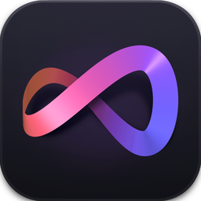
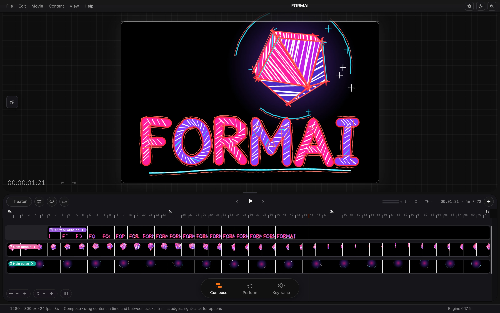
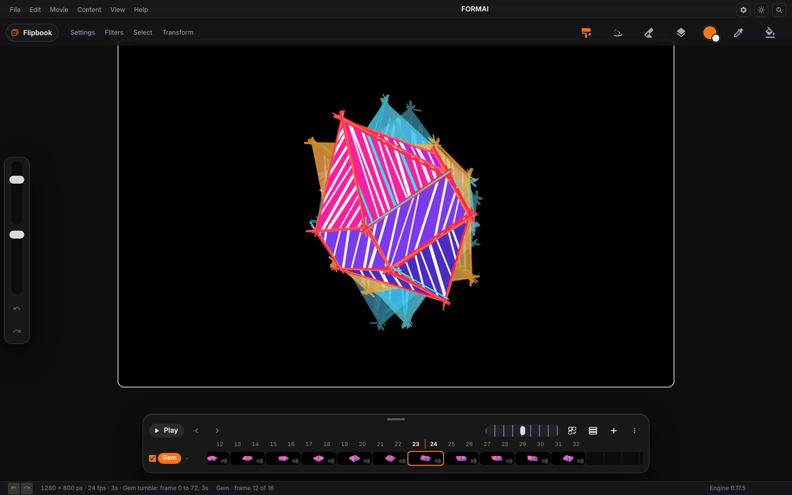
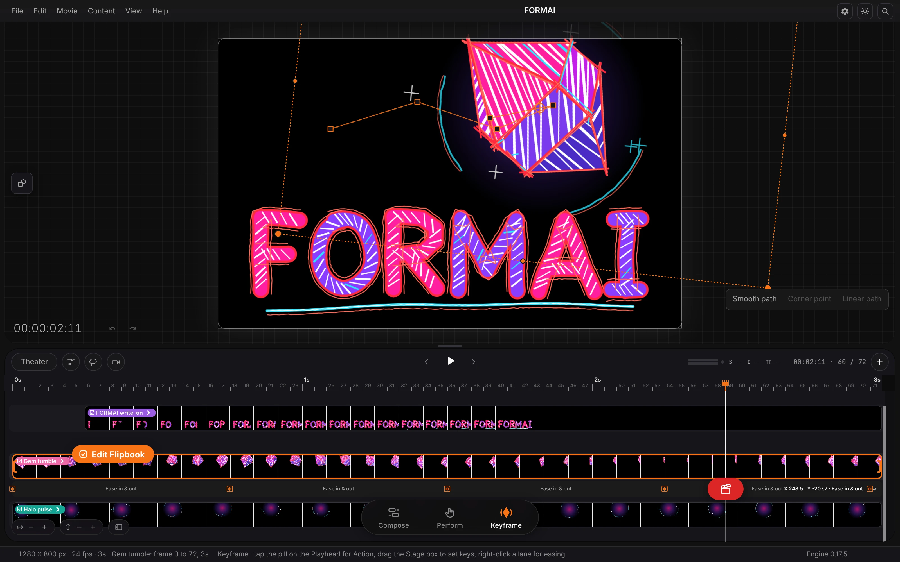
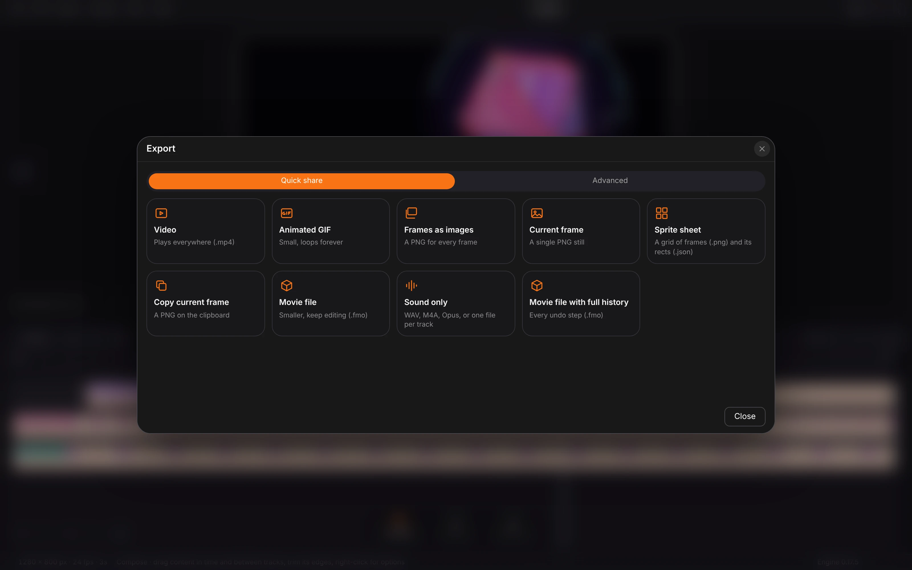

<p align="center">
  
</p>

<h1 align="center">FormMorpheus</h1>

<p align="center">
  <b>Animation; a Stage over a Timeline, drawn frame by frame, keyframed or performed live.</b><br>
  Drawings, flipbooks, pictures, text, video and sound on tracks,<br>
  in one window with no account. Offline, and yours.
</p>

<p align="center">
  
  
  
  
  
  
  
</p>

<p align="center">
  <a href="https://formai.studio/"><b>Download FormMorpheus on formai.studio</b></a> ·
  <a href="#run-it-from-source">Run it from source</a>
</p>

<br>

<p align="center">
  
  <br>
  <sub>FORMAI: a 16-drawing tumbling gem and a stroke-by-stroke lettering write-on on three tracks (FORMAI, Solid, Glow), drawn in FormMorpheus.</sub>
</p>

<p align="center">
  <a href="#features">Features</a> ·
  <a href="#everything-in-the-box">In the box</a> ·
  <a href="#under-the-hood">Under the hood</a> ·
  <a href="#download">Download</a> ·
  <a href="#run-it-from-source">Run from source</a>
</p>

<br>

<table>
  <tr>
    <td width="25%" valign="top">
      <h3>Stage over Timeline</h3>
      One screen: the movie frame above, tracks of content below, with a frame-accurate timecode, and a Build panel beside the Stage for characters, actions, scenes, props, effects, Create and Camera.
    </td>
    <td width="25%" valign="top">
      <h3>Three ways to animate</h3>
      Compose blocks on tracks, set keyframes with easing, or perform a drag live and record it as keys.
    </td>
    <td width="25%" valign="top">
      <h3>Draw frame by frame</h3>
      Flipbooks with holds and onion skins, plus a full paint canvas with a brush library.
    </td>
    <td width="25%" valign="top">
      <h3>Safe by default</h3>
      Every edit is an undo step saved inside the movie, with Recently Deleted and crash recovery.
    </td>
  </tr>
</table>

## Features

<table>
  <tr>
    <td width="50%" valign="top">
      
      <br><sub>Flipbook editing with onion skins tinted backwards and forwards.</sub>
      <h3>Flipbooks and onion skins</h3>
      Draw each frame, hold it as long as you need, and see the drawings before and after it as ghosts.
    </td>
    <td width="50%" valign="top">
      
      <br><sub>Keyframe mode: the FORMAI write-on with a Move lane and an ease between the keys.</sub>
      <h3>Keyframe mode</h3>
      Key Move and Scale and live filters on lanes under each block, with ease and hold curves between keys.
    </td>
  </tr>
  <tr>
    <td width="50%" valign="top">
      
      <br><sub>The Export dialog: quick share targets, with an Advanced tab for codec, resolution and range.</sub>
      <h3>Export</h3>
      Write video, animated GIF, image frames, a sprite sheet, a single frame or sound only, and save presets.
    </td>
  </tr>
</table>

## Everything in the box

<table>
  <tr>
    <td width="33%" valign="top">
      <h4>Content blocks</h4>
      Drawings · Flipbooks · Pictures · Video · Sound · Text · Shapes · Solids · Adjustments · Groups · Characters · Character Builder · 26 starter characters · 10 starter scenes · Scenes of your own · 49 props
    </td>
    <td width="33%" valign="top">
      <h4>Animation tools</h4>
      Compose · Keyframe · Perform · Graph editor · Motion paths · Pivots · Parenting · Camera, with ready-made moves and depth · Bones · Warp · Lip-sync · Actions, 12 ready to apply · Walk To Here · Character views · Scenes on the Timeline · Scene effects, 13 ready to lay · AI Voice, spoken onto the Timeline · Subtitles, drawn in every export
    </td>
    <td width="33%" valign="top">
      <h4>Formats</h4>
      Opens: video, sound, GIF, TIFF, PSD, ORA, KRA, SVG parts, fonts · Saves: MP4, WebM, MOV, GIF, image frames · Native: <code>.fmo</code>, <code>.fmact</code>
    </td>
  </tr>
</table>

**Coming from another animation app?** Layered `.procreate` artwork opens as a Drawing with its layers, blend modes and groups. Another app's movie project file cannot be read, so bring the movie over as what that app exports: a video (MP4 or MOV, in H.264, HEVC or ProRes, with its transparency), a folder of numbered PNG frames, which becomes one Flipbook, or an animated GIF, which becomes a Flipbook with its holds. See "Coming from another animation app" in [`docs/MANUAL.md`](docs/MANUAL.md).

## Under the hood

- **Stack:** a vanilla TypeScript and Vite interface, a Python and FastAPI engine and a Tauri 2 desktop shell.
- **Decoupled core:** the movie model, ops, history and renderer in `frontend/src/engine/` never touch the DOM.
- **Movies:** `.fmo` files hold the movie, assets and undo history; ProRes and HEVC export use your own ffmpeg, or the family's LGPL build that Preferences, Video Tools downloads on request.
- **Perform:** drag a block on the Stage while the movie plays and the gesture becomes keys at the movie's frame rate.
- **Characters:** build one in the Character Builder by choosing a kind, body, face, hair and outfit, start from one of 26 original starter characters, or open an SVG with one group per body part. Every character has named parts, pivots and parenting, and a built one has a part for every joint, from hip and forearm to shin, foot, eyes, brows, hair and tail, with a mouth ready for lip-sync. Save it to the Characters library, apply the 12 starter actions or your own, change a built one again with Edit in Character Builder and keep its animation, and send any character to a vector app and back, where it updates by part name and keeps its animation. A built character turns to the front, three-quarter, side or back view and can walk to a spot. Ten starter scenes and 49 props are included, and you can save your own scenes.
- **Agents:** an MCP server at `/mcp` with a small core tool list, and a terminal panel for Claude Code, Codex, Cursor and Antigravity. A change waits for your yes in the window unless you allow agents; see [`.docs/wiki/Agents.md`](.docs/wiki/Agents.md).
- **AI Voice:** type what to say and the spoken sound lands on the Timeline like any sound, ready for fades, pan, lip-sync and export. A built-in offline voice (Kokoro, 54 voices, set up once from the card), a voice app on this computer for a cloned voice, or an online voice with your own key. On iPad: the online voice, or a speech server on a computer on the same network; the built-in voice needs a computer. Each spoken sound keeps its words and sentence timing, and adds its subtitles by itself. See `docs/MANUAL.md`.
- **Subtitles:** tick one box and the lines are drawn on the Stage and in every export, in one look for all of them: font, size, position, color and a dark band. AI voices add theirs when they speak; for a recording or a sound file, listening runs on this computer with its own model, a one-time download of about 80 MB, and sends nothing anywhere (on iPad it uses the iPad's own speech recognition instead, with no download). Edit the lines in the card, and import or export `.srt` and `.vtt`. See `docs/MANUAL.md`.
- **In your language:** the interface ships in 30 languages, right to left included, with a manual on F1.
- **iPad:** the iPad app in `ios/` wraps the same interface in a Swift shell with Apple Pencil, Files and AVFoundation export. It is built and runs on an iPad Pro 13-inch (M5) with Apple Pencil Pro on iPadOS 26.3, where drawing, squeeze, barrel roll and hover were checked. Version 0.38.0 adds AI Voice, listening for subtitles and My scenes to the iPad app; these are new there and wait for their check on the device (the list is in the build guide). The iPad app has no built-in voice, no Save to a chosen folder in Export, no outside agents or terminal panel and no Pen Link. It is a beta that you build yourself on a Mac with Xcode: see [`docs/ios/BUILD.md`](docs/ios/BUILD.md). An App Store version is planned only if the iPad app gets real adoption.

## Download

| Platform | Download | Release |
|---|---|---|
| macOS | [Download FormMorpheus for macOS](https://formai.studio/get/formmorpheus/macos) | [FormMorpheus releases on FormCompiler](https://github.com/nodemode-dev/formcompiler/releases?q=formmorpheus-v&expanded=true) |
| Windows | [Download FormMorpheus for Windows](https://formai.studio/get/formmorpheus/windows) | [FormMorpheus releases on FormCompiler](https://github.com/nodemode-dev/formcompiler/releases?q=formmorpheus-v&expanded=true) |
| Linux | [Download FormMorpheus for Linux](https://formai.studio/get/formmorpheus/linux) | [FormMorpheus releases on FormCompiler](https://github.com/nodemode-dev/formcompiler/releases?q=formmorpheus-v&expanded=true) |

All FormMorpheus builds are compiled and released from [FormCompiler](https://github.com/nodemode-dev/formcompiler); this repo holds the source.

## Run it from source

Prefer it in your browser, or want to contribute? Run the web UI straight from this repo.

**Requires:** Node 20.19+ or 22.12+ and Python 3.12+. `./formmorpheus doctor` checks them.

```sh
git clone git@github.com:nodemode-dev/formmorpheus.git
cd formmorpheus
./formmorpheus_oc_install   # installs the frontend and engine dependencies
./formmorpheus              # web UI at http://localhost:5194
```

`./formmorpheus desktop dev` opens the desktop window instead. On Windows use `formmorpheus_oc_install.bat` and `formmorpheus.bat`. On a Mac with Xcode, `./formmorpheus ios` builds the iPad app; see [`docs/ios/BUILD.md`](docs/ios/BUILD.md), with TestFlight and App Store steps beside it.

The interface runs on port 5194 and proxies `/api` and `/mcp` to the local engine on 127.0.0.1:9494. `FORMMORPHEUS_DATA_DIR` moves the engine's data and movie library, and `FORMMORPHEUS_PORT` sets the engine port.

> [!IMPORTANT]
> **Status:** in development. The Linux desktop build is tested; the macOS and Windows builds are configured but untested here.

**Contributing:** branch from `main`, keep changes to source here, and leave packaging and releases to formcompiler. See [`CONTRIBUTING.md`](CONTRIBUTING.md), the [code of conduct](CODE_OF_CONDUCT.md) and [`AGENTS.md`](AGENTS.md); security problems go through [`SECURITY.md`](SECURITY.md).

## Repository

| Path | What it is |
|---|---|
| `frontend/` | the interface: engine, paint core, Stage, Timeline, media and export |
| `backend/` | the engine service: movie library, exports, Recently Deleted, crash recovery |
| `src-tauri/` | the Tauri 2 desktop shell |
| `ios/` | the iPad app: Swift shell, engine bridge, Pencil, export and memory |

---

## Maintainers

| Maintainer | Role |
|---|---|
| [@nodemode-ai](https://github.com/nodemode-ai) | Owner |
| [@gbarnai](https://github.com/gbarnai) | Co-owner |

Code owners are set in [`.github/CODEOWNERS`](.github/CODEOWNERS).

## License

FormMorpheus is licensed under the Apache License 2.0 ([`LICENSE`](LICENSE), SPDX `Apache-2.0`). Third-party notices: [`NOTICE.md`](NOTICE.md).
