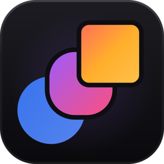

<p align="center">
  
</p>

<h1 align="center">formmorpheus</h1>

<p align="center"><b>The animation studio of the form family: a Stage over a Timeline, drawn frame by frame or performed live.</b></p>

<p align="center">
  
  
  
  
</p>

## What it is

formmorpheus is a desktop animation studio for macOS, Linux & Windows, built in the image of its siblings formvis (image) & formvfx (compositing). A movie is a Stage on top & a Timeline below: tracks hold content blocks (drawings, flipbooks, pictures, text, groups, later video & sound) that you arrange in Compose mode, animate by hand in Keyframe mode, or record from live gestures in Perform mode. Movies save as `.fmo` files w/ their full undo history inside. An iPad edition, MorpheusMobile by FormAI, follows once formmorpheus is stable.

**Stack:** vanilla TypeScript + Vite · Python + FastAPI · Tauri 2 · **Scale:** v0.5.0, phases 1 to 9 of 12

## Highlights

- **Stage over Timeline** one screen, resizable split, a dimmed backstage around the movie frame & a frame-accurate timecode
- **Tracks of content** move in time & between tracks, trim, Free Trim (Alt) that ripples neighbours, split at the Playhead, duplicate, duplicate after, fill duration, group & ungroup, box select
- **Content options** opacity, 17 blend modes plus passthrough for groups, clipping, alpha & luminance masks w/ invert, highlight colours, rename
- **Compose on the Stage** drag to move, corner handles to scale, a handle to rotate (Shift snaps to 15 degrees), snapping to centre & quarter lines
- **History that lasts** every edit is one undo step, drags merge into one, depth 10 to unlimited, saved inside the `.fmo`, w/ automatic recovery points when you branch after 3 or more undos
- **Movie settings** resolution up to 3840 px a side, 12 to 120 fps presets & custom, duration by timecode, transparent background, loop, ping pong or one shot playback
- **Draw & Paint** a full-area canvas w/ an original brush library of 18 brushes in 7 sets, paint, smudge & erase, pressure, tilt & streamline smoothing, a size & opacity sidebar, drawing layers w/ blend modes, clipping & alpha lock, a color panel (disc, classic, harmony, value, palettes), color drop fill, select (automatic, freehand, rectangle, ellipse), transform (freeform, uniform, distort, warp) & adjustment filters
- **Flipbooks** frame by frame animation w/ multiple tracks, holds, insert, duplicate, cut, copy & paste of frames, onion skins tinted forwards & backwards, a floating frame strip w/ playback, & conversion to & from tracks of drawings
- **Perform** drag a block on the Stage while the movie plays & your gesture becomes keys at the movie's frame rate (lift to pause, drag to resume), w/ motion filtering that thins the keys, pen barrel roll, & card sliders that record filters
- **Video & sound** import video, sound, animated GIFs (as Flipbooks), TIFF & fonts; frame-accurate video, waveforms & filmstrips on the Timeline, sound locked to the picture by the audio clock, scrubbing, volume & Volume keys, separate audio from video
- **Export** MP4, WebM (w/ transparency), MOV, animated GIF w/ its own palette & dithering, PNG, JPG or WebP frames, the current frame, ranges & ping pong; exports are kept on the Home screen's Exports page
- **Keyframes** Move & Scale plus live filters (opacity, Gaussian blur, sharpen, noise, hue saturation brightness, lens blur) keyed on lanes under each block, easing (linear, ease in, ease out, ease in & out, hold), expanded per-channel rows, copy, paste & reverse
- **The form family shell** the same splash & reveal, title bar, menus (in the window or the macOS menu bar), Home screen, Preferences & status bar as formvis, w/ 28 shared themes & zero flash on load

## Quick Start

### Requirements

Node 20.19+ or 22.12+, Python 3.12+. Desktop builds also need Rust (`https://rustup.rs`). `./formmorpheus doctor` checks them.

### macOS & Linux

```shell
chmod +x formmorpheus_oc_install formmorpheus
./formmorpheus_oc_install
./formmorpheus
```

Desktop app:

```shell
./formmorpheus desktop dev
./formmorpheus desktop build
```

### Windows

```shell
formmorpheus_oc_install.bat
formmorpheus.bat
```

### Ports

| Service | URL | Notes |
|---|---|---|
| Frontend | http://localhost:5194 | Vite dev server, `server.host` false, proxies `/api/*` to the backend |
| Backend | http://127.0.0.1:9494 | FastAPI/uvicorn, local only; `./formmorpheus serve` also serves the built interface here |

## Configuration

| Variable | Purpose |
|---|---|
| `FORMMORPHEUS_DATA_DIR` | where the engine keeps its data & the movie library (default: the platform's app data folder) |
| `FORMMORPHEUS_LIBRARY_DIR` | a different folder for the movie library |
| `FORMMORPHEUS_PORT` | the backend port (desktop app: 0, a free port) |
| `FORMMORPHEUS_DEV_URL` | debug desktop builds only: load this interface URL instead of the engine's |

Set them in the shell. No `.env` is read or committed.

## Architecture

```
formmorpheus/
├── frontend/              the interface (vanilla TS + Vite)
│   ├── src/engine/        the decoupled engine: movie model, ops, flipbook & keyframe ops, history, renderer, no DOM
│   ├── src/paint/         the paint core: brushes, strokes, layers & paint history, fill, select, transform, filters, no DOM
│   ├── src/ui/            Stage, Timeline, Draw & Paint, popovers, the form family shell
│   ├── src/media/         video decoding, the audio engine & clock, import of pictures, video, sound & fonts
│   ├── src/export/        rendering & encoding MP4, WebM, MOV, GIF & frames
│   ├── src/io/            the engine service client & the .fmo format
│   ├── src/app/app.ts     wiring: commands, menus, keys, save & open
│   └── src/styles/        tokens & stylesheets (tokens only, z-index from the scale)
├── backend/               the engine service (FastAPI): library of .fmo movies, kept exports, capabilities
├── src-tauri/             the desktop shell (Tauri 2): splash, reveal, title bar, engine sidecar
├── setup/                 install, boot, freeze & desktop scripts behind ./formmorpheus
└── assets/                repo-level art (not wired into the build)
```

## Status

Phases 1 to 9 of the plan have landed: the shell, the movie model w/ saved history & `.fmo` files, the Timeline in Compose mode, Draw & Paint, Flipbooks w/ onion skins, Keyframe mode w/ easing & live filters, Perform mode, video & sound, & export. Next are engine jobs & desktop distribution (ProRes & HEVC through ffmpeg, signed builds, translations), the stability gate, & the iPad edition MorpheusMobile after it. The desktop shell compiles on Linux; macOS & Windows builds are untested here.

## Development

Changes follow the family's rules: single-region hand edits, zero DOM flash, tokens only, no emoji, decisions & removed code in `frontend/HASHOUT_LOG.md`, `backend/HASHOUT_LOG.md` & `src-tauri/HASHOUT_LOG.md`. Commits are Conventional Commits as `nodemode-ai <mackin@nodemode.ai>` w/o attribution trailers.

## Contributors

- nodemode-ai · owner

## Licensing

Apache-2.0, see `LICENSE` & `NOTICE.md`.
