# FormMorpheus Manual

FormMorpheus is an animation studio: a **Stage** on top, a **Timeline** below. You arrange blocks of content on tracks, draw frame by frame, animate with keyframes, or perform a move live and let the app record it. This manual covers the whole app in short sections. In the app, open it from Help · FormMorpheus Manual, or press F1.

On macOS use Cmd where this manual says Ctrl. The table of keys is under Keyboard shortcuts.

## Getting started

1. Start the app. The **Home** screen opens first.
2. Choose **New movie** (Ctrl+N), pick a size and a frame rate, and press create. Or choose **New flipbook** to start a frame by frame animation. Or choose File · **New from Starter Scene...** and pick a scene: a new movie opens with the scene's background and props, each on its own track, and a guide line on the floor. A starter character added from the Characters panel then stands on that floor at half its size, and in a movie of another size than 1920 by 1080 it stands on the floor at the scene's size.
3. Add content with the round **Create** button at the right of the Timeline: Drawing, Flipbook, Text, Track, or Import.
4. Press Space to play. Press Space again to pause. To see the movie as it will look when finished, press **Preview** in the Timeline's top row: it plays from the first frame, full screen, and Escape leaves.
5. Save with Ctrl+S. The first save asks for a name.

You can also drop pictures, video or sound anywhere on the window to bring them into the movie.

## The screen

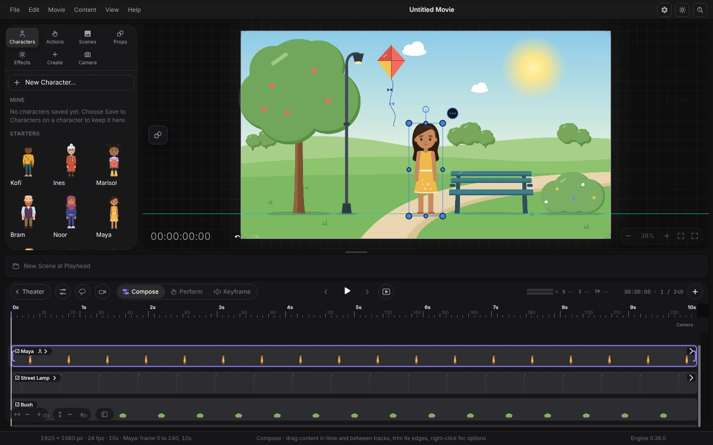

- **Title bar and menus**: File, Edit, Movie, Content, View and Help. On macOS the menus can sit in the system menu bar, or in the window (View · Menus in Window).
- **Stage**: the movie frame, with a dimmed backstage around it. Content shows here as it will export. A timecode shows the Playhead position.
- **Build panel**: a column beside the Stage with seven tabs: Characters, Actions, Scenes, Props, Effects, Create and Camera. Open it with View · Build Panel. See The Build panel below.
- **Scene strip**: a row of scene cards above the Timeline. See Scenes on the Timeline.
- **Timeline**: tracks of content blocks, with the Playhead, the play controls, a Preview button, the Movie settings button, Multi-select, Camera mode, the Compose, Perform and Keyframe switch and the Create button.
- **Split**: drag the line between Stage and Timeline to give either more room. The place is remembered.
- **Status bar**: shows the engine state, running jobs and short notices.
- **Command search**: Ctrl+K lists every command. Type a few letters and press Enter.

Drag the Timeline with the wheel: the wheel scrolls tracks, Shift+wheel or a sideways swipe moves in time, Ctrl+wheel zooms. Ctrl+= and Ctrl+- zoom, Ctrl+0 fits the whole movie.

### The Build panel

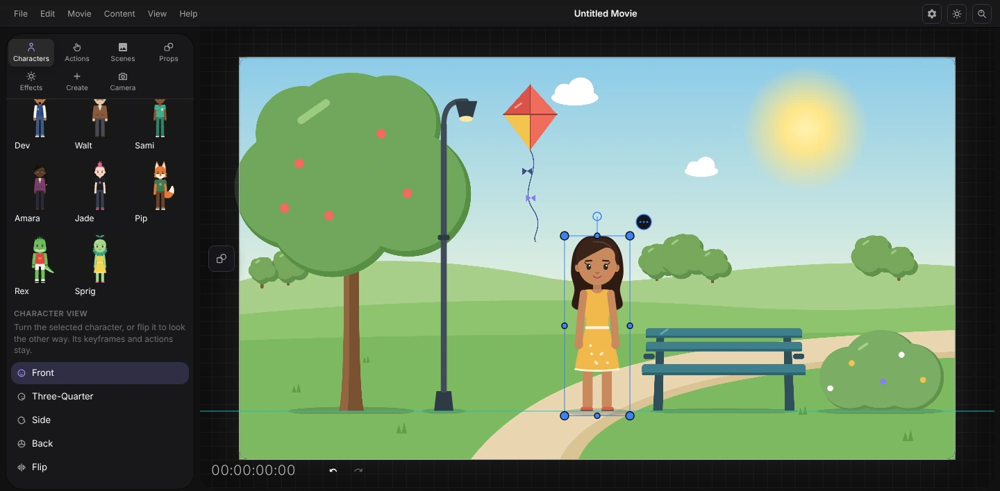

The Build panel sits beside the Stage, not over it. Choose View · Build Panel to show or hide it. It is there only while a movie is open in the editor: not on Home, in Draw and Paint, or in the full-screen preview. It remembers whether it is open and which tab you were on, and it starts closed on a window narrower than 1100 px. Its seven tabs sit in two rows. Use the arrow keys to move between them.

- **Characters**: **New Character...** opens the Character Builder. **Mine** lists the characters you saved and **Starters** lists the built cast. A click adds that character to the movie at the Playhead. At the end of the tab, a **Character view** section turns the selected character to the front, three-quarter, side or back view, or flips it (see Character views).
- **Actions**: the actions of the selected character, its own first and then the starter actions. A click applies one the way Apply Action... does, so it plays once. With no character selected the tab says "Select a character to see its actions."
- **Scenes**: **My scenes** at the top, with **Save as Scene...** above them, and then the starter scenes. A click on a scene adds its backdrop and props behind everything in the movie. **Background Color...** under the starter scenes sets the Stage's background. See Starter scenes and My scenes.
- **Props**: 49 ready-made objects to add to the movie, in three styles and eight categories, with a search box. See Props.
- **Effects**: weather, particles and light to lay over the whole movie, and a list of the ones already in it. See Scene effects.
- **Create**: the rows of the Create card: Drawing, Flipbook, Text, Track, shapes, pictures, video and sound to import, Record sound, AI Voice and Subtitles. A row is greyed out when its command is.
- **Camera**: **Camera mode**, which turns the camera frame on the Stage on; **Camera moves**, ready-made moves with a length of 0.5, 1, 2 or 4 seconds; **Transitions**, the group transitions Crossfade, Dip to Color, Wipe and Push, and Remove Transition; and **Depth**, which sets how much each picture track moves with the camera. See Camera.

## Modes

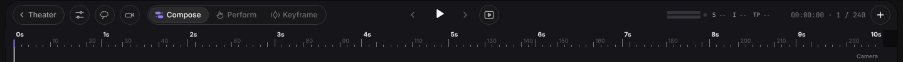

The three modes change what dragging on the Stage does. They are a compact switch in the Timeline's top row, after the Theater and Camera mode buttons; when the row is narrow only the icons show, and each keeps its name as a tooltip. Switch with Ctrl+1, Ctrl+2 and Ctrl+3, or from the View menu.

| Mode | Keys | Dragging a block on the Stage |
|---|---|---|
| Compose | Ctrl+1 | moves, scales and rotates it as a plain edit |
| Perform | Ctrl+2 | plays the movie and records your gesture as keys |
| Keyframe | Ctrl+3 | writes keys at the Playhead for the change you make |

## Movies and .fmo files

A movie is saved as a single `.fmo` file. It holds every track, drawing, picture and sound, and the full undo history, so you can undo after reopening.

- **Save** (Ctrl+S) writes to the movie library. **Save As** (Shift+Ctrl+S) saves a copy under a new name.
- **Open** (Ctrl+O) shows your movies. **Open Movie File** (Shift+Ctrl+O) opens a `.fmo` from anywhere.
- **Open Recent** in the File menu lists your latest movies.
- **Share Movie File** downloads a `.fmo`; with history, it keeps the undo steps too.
- **Autosave** can write the open movie every 10 seconds to 5 minutes (Preferences · General).
- **Movie settings** (Ctrl+J): size up to 3840 pixels a side, frame rate presets from 12 to 120 and custom, duration by timecode, transparent background, and playback as loop, ping pong or one shot. Nothing in it is cut off at the right edge, and long labels wrap. Menus are never taller than the window: a long menu scrolls inside itself and uses compact rows.

Where the library lives is shown in Preferences · General. The `FORMMORPHEUS_LIBRARY_DIR` variable moves it.

## Compose

In Compose you build the structure of the movie.

- **Select** a block by clicking it. Shift, Ctrl or Cmd adds to the selection. Multi-select (Shift+M) turns every click into an add. Drag in an empty area to box select. Ctrl+A selects all.
- **Move** a block in time by dragging it along its track, or to another track.
- **Trim** by dragging either edge. Hold Alt for **Free Trim**, which ripples the neighbours.
- **Split** at the Playhead with Ctrl+B.
- **Duplicate** (Ctrl+D) or **Duplicate After** (Alt+Ctrl+D), **Fill Duration** to stretch a block to the next one.
- **Group** (Ctrl+G) and **Ungroup** (Shift+Ctrl+G).
- **Copy, Cut, Paste** with Ctrl+C, Ctrl+X, Ctrl+V.
- **Delete** with Delete or Backspace. A Preferences option asks first.
- **Right-click** a block for its options: opacity, volume, rename, highlight color, blend mode, mask, invert, reverse keyframes, convert to Flipbook, group, and track options.
- **Foreground and background.** Each block is drawn on its track, and the order of the tracks is the stacking order: the track at the top of the Timeline is in front, and the track at the bottom is at the back. To put something in front of another, move its track above the other's with Move up or down in the track options, or right-click the content and choose **Arrange**: Bring to Front, Bring Forward, Send Backward or Send to Back moves it forward or back, by moving its track in the stack.
- **Right-click** a track name for track options: rename, show all, hide all, add track above, move up or down, remove an empty section, delete.
- **Right-click** content on the Stage for the same menu as its block. A right-click on empty Stage opens the Stage's own menu. The menu has Duplicate and Delete, and an **Arrange** group: **Bring to Front**, **Bring Forward**, **Send Backward** and **Send to Back**. They move the content's track in the stack, since the track higher up is drawn in front, and each is one undo step. On a character the menu also has **Apply Action...** (see Actions).

On the Stage, the selection box hugs what is drawn: a character's box is the character, and a drawing's box is its ink, not the whole movie frame. A click picks the content under the pointer, and a click on empty Stage selects nothing, even inside where an old big box was. A drag that starts on the selected content moves it and never selects something else; a plain click there picks what is on top. Drag a selected block to move it, drag a corner handle to scale, and drag the rotate handle to turn it. In Compose the corner and rotate handles work about the box's centre. Side nodes on a character or a group scale it whole and keep its proportions; hold Alt to stretch one way. Shift snaps rotation to 15 degrees. Moves snap to the centre and quarter lines.

**Content options**: opacity, 26 blend modes (and passthrough for groups), clipping, alpha and luminance masks with invert, and highlight colors for finding blocks.

**Undo** (Ctrl+Z) and **Redo** (Shift+Ctrl+Z or Ctrl+Y) step through your edits. A drag counts as one step. The depth is set in Preferences · Timeline, from 10 to unlimited.

### Transitions

A transition mixes one block into the next where two blocks touch on one track: the first block must end on the frame where the second begins. It is centred on that cut, with half of its length before the cut and half after. In the half before the cut, the first block keeps playing while the second waits on its first frame. In the half after the cut, the second block plays while the first holds its last frame.

- **Add one:** select the second block, right-click it, and choose **Time**, then **Transition**. The row is greyed out unless the block follows another block that touches it. Choose **None** to remove it.
- **The four kinds:**
  - **Crossfade** blends the first block into the second.
  - **Dip to Color** fades the first block to a color and then from that color into the second. The **Color** field in the same menu sets the color; the default is black.
  - **Wipe** uncovers the second block over the first from one side.
  - **Push** slides the second block in from one side while it pushes the first block out the other way.
- **Direction** (Wipe and Push only): **From left** (the default), **From right**, **From top** or **From bottom** is the side the second block comes from.
- **Length:** the **Frames** field in the Transition menu sets it. The shortest is 2 frames; a new transition is half a second long at the movie's frame rate. On the Timeline a band marks the transition over the cut, with a handle at its right end: drag it to change the length. Dragging cannot make it longer than twice the shorter of the two blocks. The Frames field takes any whole number of 2 or more.
- **Inside a group:** the commands **Group Transition: Crossfade**, **Group Transition: Dip to Color**, **Group Transition: Wipe**, **Group Transition: Push** and **Group Transition: None** act on the cut nearest the Playhead between two touching blocks inside the selected group. The Camera tab of the Build panel has the same five as tiles (see Camera).

## Scenes on the Timeline

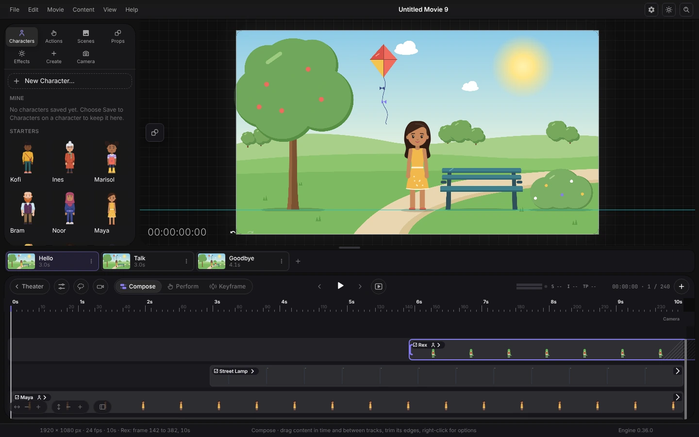

A movie is one timeline with one set of tracks. **Scenes** cut that timeline into named stretches, so you can find, loop, copy and reorder them. They are shown as a **scene strip**, a row of cards above the Timeline. A scene runs from its start to the start of the next one, and the last runs to the end of the movie.

- **Make a cut.** Put the Playhead where a new scene starts and press **New Scene at Playhead** in the strip (or Movie · Scenes). In a movie with no scenes, the first press makes Scene 1 from the start and a second scene at the Playhead. The new card opens for a name; type it and press Enter. A scene cannot start on a frame where another one starts.
- **A card** shows a small picture of the scene's first frame, its name and its length. Click it to put the Playhead at the scene's start. Double-click it to rename it. The round plus after the last card makes another cut at the Playhead.
- **The card's menu** (the three dots, or a right-click on the card):
  - **Go to Scene** (the command is named Go to Scene Start) and **Rename Scene**.
  - **Focus on Scene** makes the Timeline show just that stretch and sets the loop range to it, so playback loops inside the scene. Choose it again, shown ticked, to **Show Whole Movie**.
  - **Duplicate Scene** puts a copy of the scene, with copies of everything in it, right after it.
  - **Move Scene Earlier** and **Move Scene Later** swap the scene with its neighbour.
  - **Add Empty Scene After** adds 3 seconds of nothing after the scene; what follows moves later.
  - **Delete Cut, Keep Content** takes away the cut at the scene's start, so the scene joins the one before it. The first scene has no cut before it.
  - **Delete Scene and Content** removes the scene and everything in it; what follows moves up. The only scene cannot be deleted.
- **What travels with a scene.** Content, keyframes, camera keys, markers, subtitles and scene effects move, copy and delete with the scene they are in. Content that crosses a cut is split at the cut first when the scene is moved, duplicated or deleted.
- **Commands.** Movie · Scenes holds New Scene at Playhead, Previous Scene, Next Scene and the card's actions for the scene at the Playhead.
- **Limits.** You cannot drag a card to reorder: use Move Scene Earlier and Move Scene Later. A movie keeps one set of tracks for the whole movie, so a scene has no tracks of its own. The scenes are saved in the `.fmo`.

## Draw and Paint

Add a **Drawing** and open it (double-click it, or use the Edit pill that appears on the Timeline) to enter the full-area canvas. Press Enter or Escape to finish and return to the Stage.

### Brushes

The brush library holds several hundred brushes in libraries of sets (sketching, inking, painting, airbrushing, charcoals, textures, water and more), plus Recent and any libraries you import. Three tools use them:

- **Paint** (B), **Smudge** (S) and **Erase** (E). Click an active tool again to open the brush panel.
- The side bar has two sliders, brush **size** and **opacity**. `[` and `]` change the size.
- Each slider has four small markers, the remembered values of that brush. Tap a marker to recall its value. Press and hold it (or Shift or Alt click) to store the current value there.
- Pen pressure, tilt and streamline smoothing shape the stroke.

### Layers

Press L for the layers panel. Each Drawing has its own layers with:

- a blend mode and opacity
- **clipping** to the layer below
- **alpha lock** to paint only where there is paint
- rename, duplicate, merge down, clear and delete
- **groups**: the New Group button at the top of the panel makes one, and a layer's menu has Group. A group has its own blend mode and opacity.
- **masks**: a layer's menu has Add Mask. Tap the mask thumbnail to paint on it, and open its menu for Mask Enabled, Invert Mask, Apply Mask and Delete Mask.

### Color

Click the color swatch for the color panel: a disc, classic squares, harmony, value sliders and palettes. Drag the swatch onto the canvas to fill a shape or an enclosed area.

- **Threshold**: after the drop, keep the pointer down and drag sideways. A bubble shows the threshold, and the fill follows it. Lift to keep the fill as one undo step.
- **Continue fill**: later taps fill with the same color until you pick another tool.
- **Eyedropper loupe**: hold Alt (or touch and hold) over the canvas for a round magnifier that shows the color under it. Release to pick.

### Select

The bottom capsule switches between Paint, Select, Transform and Filters. Select has four ways to pick: **Automatic** (by color area), **Freehand**, **Rectangle** and **Ellipse**. Add to or subtract from a selection, invert it, clear it (Ctrl+D), fill it, clear its pixels, or copy it to a new layer.

### Transform

Move, scale and turn the selection or the layer. The modes are **Freeform**, **Uniform**, **Distort** and **Warp**. Choose Nearest, Bilinear or Bicubic for the resampling. Enter applies. Escape cancels.

- The arrow keys **nudge** by 1 pixel, and Shift+arrow by 10.
- Warp has a mesh from 4 x 4 up to 8 x 8. Tap the Mesh row to change the size; each node also has bending handles to shape the curve through it.

### Filters

Adjustment filters with live preview and a slider for each value: Hue, Saturation, Brightness, Gaussian Blur, Sharpen, Noise and Lens Blur. They apply to the layer or the selection.

### Zoom and pan

Use the wheel to pan, Ctrl+wheel to zoom, hold Space to drag the canvas, and press 0 to fit. With two fingers you can pan, zoom and turn the canvas at once; a quick pinch in fits it to the screen. Shift+drag with the Space hand turns the canvas, and R sets it upright again.

## Flipbooks and onion skins

A **Flipbook** is frame by frame animation inside one block on the Timeline. It has one or more tracks, each a row of frames that play in order and loop.

- Open a Flipbook to draw. The **frame strip** floats over the canvas.
- **Add frame** and **Add track** are the two buttons at its left.
- On a frame that holds for several movie frames, **Add frame** ends the hold at the Playhead and adds there. **Press and hold** Add frame (or Alt-click it) to jump to the end of the hold and add the new frame after it.
- **Paste** fills the next free (blank) frame of the track, or goes on the end of the track; later frames do not move. Use Duplicate to insert a copy right after a frame.
- Drag frames into the gap between two tracks, or above the first or below the last, to make a new track; the gap is about 14 px tall and shows a drop line.
- Select a frame to draw on it. Use the arrow keys or `,` and `.` to step. On a touch screen or with a pen, dragging the strip left moves forward in time, and a flick keeps going and settles on a frame.
- Right-click a frame or track: copy, cut, paste, duplicate, insert, clear, delete, rename, hide, move up or down.
- A frame can **hold** for several movie frames, so you animate on twos or threes.
- **Onion skins** show the frames around the current one, tinted for before and after. Their settings are on the **Onions** tab of the Draw and Paint settings panel. **Blend primary frame** lets the skins blend over the frame you draw on.
- **Row masks**: right-click a row for No mask, Alpha mask, Luminance mask and Invert mask. A masking row cuts the row below it and is not drawn itself.
- Scrubbing the frame strip follows **Scrub speed** in Preferences · Timeline.
- The **Mini preview** button on the strip opens a small floating window that loops the Flipbook while you draw. Drag it where you like; it keeps its place and whether it was open.
- In Movie settings, **Loop only the visible region** makes playback loop just the part of the Timeline you see. The sound restarts at the start of that region.
- **Convert to Flipbook** turns a set of drawings on tracks into one. **Convert Flipbook to tracks** goes the other way.
- Play inside the Flipbook with the strip's play button to see just the loop.

## Keyframes and easing

Switch to Keyframe mode (Ctrl+3). Move or scale a block at a chosen Playhead frame and a **key** is written. Each kind of change sits on its own **lane** under the block.

- **Move** and **Scale** keys come from the Stage.
- **Live filters** are keyed from the block's card: Opacity, Gaussian Blur, Sharpen, Noise, Hue Saturation Brightness, and Lens Blur.
- **Volume** (Level) keys change a sound over time.
- **Easing** of the span that leaves a key: Linear, Ease in, Ease out, Ease in and out, or Hold.
- Expand a lane to see its channels as separate rows.
- Copy and paste keys, or choose **Reverse keyframes** from the block's menu.

### Warp and Distort

Both are on the **Action** menu in Keyframe mode, each with a card and handles on the Stage.

- **Distort** skews the picture by its four corners. Drag a corner.
- **Warp** bends it through a mesh of nodes. Drag a node. **Mesh size** on the card picks 2x2 up to 6x6; the shape you made is kept when the size changes.
- Each drag writes a key at the Playhead. **Reset** puts every node back at the Playhead, and **Done** closes the card.
- The offsets are in the picture's own pixels and apply before move, scale and rotation.
- In Perform mode, dragging a node while the movie plays records its keys, and one undo removes the take.

## Camera

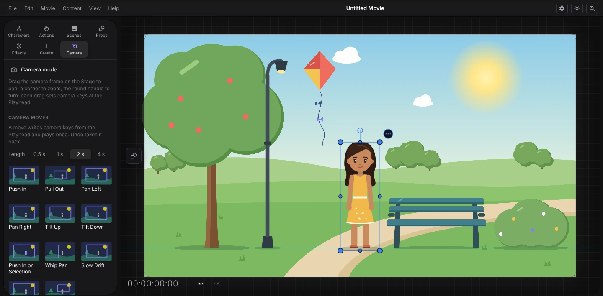

The camera pans, zooms and turns the whole movie. Turn **Camera mode** on with the camera button in the Timeline's top row, or with the first row of the Build panel's Camera tab. Then drag the camera frame on the Stage to pan, a corner to zoom and the round handle to turn: each drag sets camera keys at the Playhead, on the Camera lane at the top of the Timeline. A track set Fixed to screen ignores the camera. Subtitles are drawn after the camera, so a camera move never shifts them.

### Camera moves

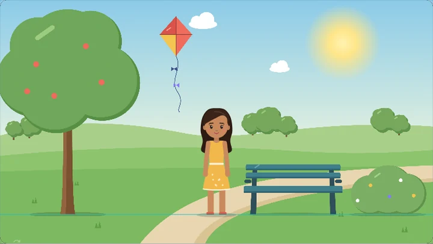

A camera move writes the camera keys for you. Open the **Camera** tab of the Build panel, choose a **Length** of 0.5, 1, 2 or 4 seconds (2 seconds unless you chose another; it is remembered), and click a tile. Each tile has a small moving diagram of what the camera does.

- **Push In** moves the camera closer to the middle of the frame, and **Pull Out** moves it back and shows more.
- **Pan Left** and **Pan Right** turn the camera sideways, and **Tilt Up** and **Tilt Down** tip it.
- **Push In on Selection** moves in until the selected content fills the frame. With nothing selected it says "Select something to push in on."
- **Whip Pan** swings in fast from the side and settles on the framing the camera has at the Playhead.
- **Slow Drift** floats the camera a little, as if held by hand.
- **Shake** shakes the camera hard and then calms it down.
- **Reset Camera Here** takes the camera back to the whole frame. Where it is already there, it says "The camera is already at rest here."

A move starts at the Playhead, writes camera keys for the length you chose, and plays once; the Playhead then goes back to where the move starts. It is one undo step. Camera keys that were already inside the move's stretch are replaced, and the key at the start takes the camera as it is there, so nothing before the move changes. A move needs room after the Playhead: when there is none, the tab says "Move the Playhead earlier: a move needs room after it." Where the camera is level and the move starts inside the movie, a move zooms in just enough that no edge of the movie shows. The same moves are in Movie · Camera Moves, as Camera Move: Push In and so on.

The tab's **Transitions** tiles (Crossfade, Dip to Color, Wipe, Push and Remove Transition) are the five group transitions of Transitions in Compose, with a moving diagram each. They act inside the selected group, at the cut nearest the Playhead between two touching blocks, so they are greyed out until a group like that is selected.

### Depth

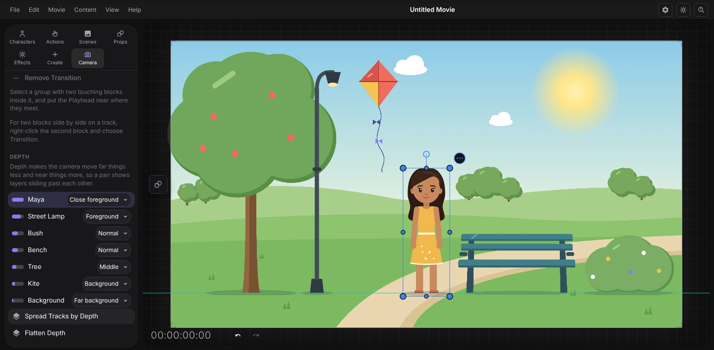

**Depth** makes the camera move far things less and near things more, so a pan or a push shows layers sliding past each other. Every track has a depth step:

| Step | How much of the camera's pan and zoom the track takes |
|---|---|
| Far background | a quarter |
| Background | half |
| Middle | three quarters |
| Normal | all of it (the default) |
| Foreground | one and a half times |
| Close foreground | twice |

- **For one track**, right-click its name and choose **Depth**, then a step.
- **In the Camera tab**, the **Depth** list shows every track that holds a picture, the front one first, each with its step in a menu. A click on a row selects that track. A track fixed to the screen is greyed out, since depth does not apply to it.
- **Spread Tracks by Depth** gives the picture tracks a step each, from Far background at the back to Close foreground at the front, in one undo step. It needs two or more picture tracks. A starter scene has one track for its background and one for each prop, so one press gives it parallax.
- **Flatten Depth** sets every track back to Normal. Both are also in the Movie menu.

Depth shows only when the camera moves, in Camera mode or through a camera move.

## Perform

Perform records a gesture instead of placing keys by hand.

1. Select a block and switch to Perform (Ctrl+2). A banner says Ready.
2. Press on the block on the Stage and drag. The movie plays and your motion is recorded as keys at the movie's frame rate. The banner says Recording.
3. Lift to pause. Press and drag again to continue. A take stops at the movie's end.
4. Undo once to remove the whole take.

**Modifications** (the gear in the banner): **Motion filtering** thins the keys while keeping the visible motion, and **Roll sensitivity** sets how much a pen's barrel roll turns the block. Sliders on the block's card (opacity, blur and the other filters) also record while the movie plays.

## Characters

A character is a Group whose inner blocks are named parts: a head, a body, arms, legs, a mouth. FormMorpheus keeps the names, so actions, lip-sync and the link to a vector app know which block is which. A character shows a small person glyph on its Timeline chip.

There are three ways to get one: build it in the **Character Builder** by choosing, start from one of the **26 starter characters** in the Characters panel, or draw it yourself in a vector app and open the SVG.

### The Character Builder

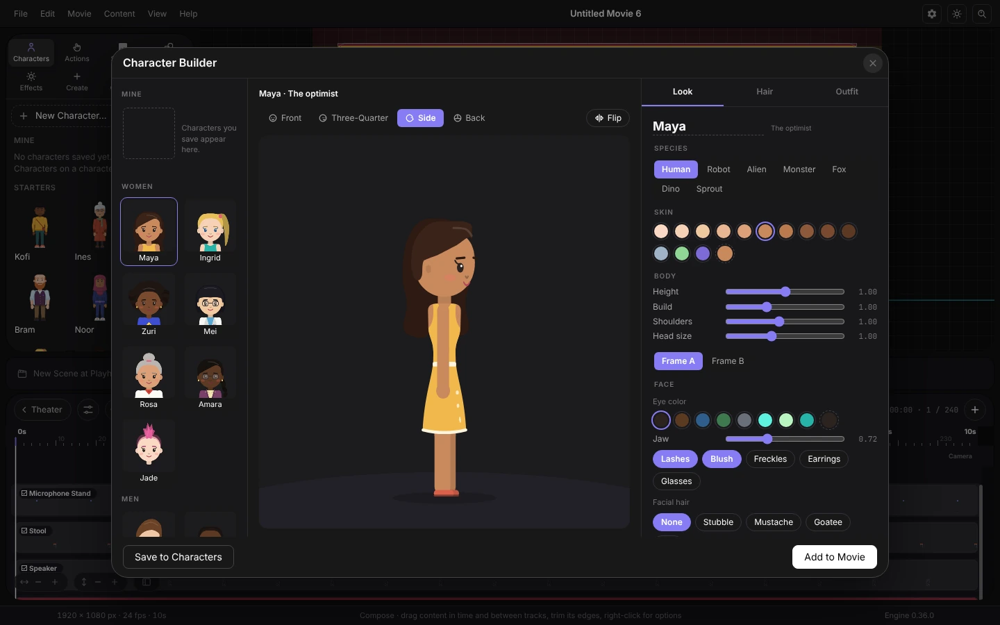

Choose **Build a character** at the top of the Characters panel, Content · **Character Builder...**, or Character Builder in command search. A large window opens in three columns.

- **Presets** on the left: the built starter characters, grouped as Women, Men and Specials, under a first group, **Mine**, that lists the characters you saved. With none saved it reads "Characters you save appear here." Press one to start from it; a saved one opens again with its recipe. Its name and what it is (The optimist, Woodland fox, ...) show above the preview.
- **The preview** in the middle shows the character as it will be added, redrawn as you change it. A **View** row above it turns the character: Front, Three-Quarter, Side and Back, and a Flip button that mirrors it. See Character views.
- **Look**: the name; the kind (Human, Robot, Alien, Monster, Fox, Dino or Sprout); skin; the body sliders Height, Build, Shoulders and Head size, and Frame A or B; and the face: eye color, Jaw, Lashes, Blush, Freckles, Earrings, Glasses, facial hair (None, Stubble, Mustache, Goatee, Full) and lip color. A kind dims the face options it does not draw: a robot has no jaw or lip color, for example. Each row of swatches ends in a custom color.
- **Frame A and Frame B** are two body frames to build on, not two appearances for one character. Choose one and the character has that frame: **A** is the lighter one, with narrower shoulders, waist and neck, slimmer arms and legs and smaller hands and feet; **B** is the broader one, with wider shoulders and waist, thicker arms and legs, a thicker neck and larger hands and feet. The body sliders then work on top of the frame. It changes the shape of the body and nothing else: skin, face, hair and outfit stay. The Women presets start on A and the Men presets on B (a special has its own), and you can set either frame on any preset or kind. Use it to pick the basic body first, then fine-tune with Height, Build and Shoulders. To keep two looks of one character, save them as two characters under two names. Nothing compares or switches between A and B once the character is built.
- **Hair**: 16 styles and None, and the hair color. A fox shows a tuft between its ears for any style but None; for a dino the hair color paints its crest and the spikes on its tail, and for a sprout its leaves and petals, so their styles are dimmed. A note beside the last style says so.
- **Outfit**: 16 outfits (Tee & Jeans, Hoodie & Joggers, Business Suit, Sundress, Athletic, Lab Coat, Chef, Hi-Vis Crew, Tuxedo, Winter Puffer, Hero Suit, Pajamas, Overalls, Varsity Jacket, Cardigan and Scrubs), each with a color for each of its three pieces. **Reset colors** puts back the outfit's own.
- **Randomize** makes a new look of the same kind, and **Reset** goes back to the preset you started from.

At the foot, **Add to Movie** puts the character in the open movie at the Playhead on a track of its own, in one undo step, at its own spot across the frame (on a starter scene's floor, standing on it), and the builder closes. **Save to Characters** keeps it in Mine with its recipe, asking before it replaces a saved name; the new character shows in the Mine group at once, marked as the one you are working on. The window stays open after a save, so you can change the look and save or add it.

### A built character's parts

A character from the Character Builder, a built starter included, is an ordinary character with a part for each piece, each following the part it hangs from and turning about a pivot at its joint:

- `hip`, with `body` on it, and `neck`, the arms and the `head` on the body
- `arm-l` and `arm-r` (the upper arms), each with its `forearm` and its `hand`
- `leg-l` and `leg-r` (the thighs), each with its `shin` and its `foot`
- on the head: `eyes`, `brows`, `mouth`, `hair-front`, `hair-back` and `hair-sway` (the hair that swings), and `head-behind` and `head-acc` for what an outfit or a kind draws behind or on the head
- what the outfit or the kind adds: `skirt` on the hip, `cape` and `hood-back` on the body, and a `tail` on the hip for a fox or a dino
- `shadow`, the shadow on the floor, which follows nothing

`-l` is the character's own left, on your right as it faces you. A piece the look does not draw makes no part, so a character in trousers has no `skirt`. The `mouth` is a mouth chart of the eight shapes drawn to match the face, so Lip-sync from Sound works on it at once. Every part can be picked, moved and keyed like a part of any character, and the starter actions know these names.

### Character views

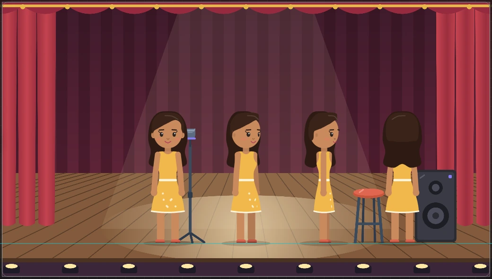

A character made in the Character Builder can face the front, three-quarters, the side or away from you, and it can be flipped to look the other way. The views are drawn from the character's recipe, so the same look, outfit and colors carry over.

- **In the builder**, the **View** row above the preview (Front, Three-Quarter, Side, Back) and the **Flip** button turn the character before it is added. See The Character Builder.
- **On the Stage**, select a character and choose Content · **Character View**: **View Front**, **View Three-Quarter**, **View Side**, **View Back** and **Flip Character**. The same rows are in the content's right-click menu and in the **Character view** section at the end of the Build panel's Characters tab. The view the character has is ticked.
- **What stays.** The character is built again in place from the new view in one undo step, and its keyframes, actions and strips, lip-sync and place stay, matched by part name.
- **Which characters.** A character made in the Character Builder, a built starter or a saved one included. The five drawn starters (Kofi, Ines, Marisol, Bram and Noor) and a character from an SVG or a drawing have one drawn view, so the rows are greyed out for them.
- **Limits.** The side view is a near profile, not a full one. The starter actions are drawn for the front view and play as they are in the other views. The three-quarter and side views face the right of the Stage; Flip makes them face left.

### Edit in Character Builder

Select a character made in the Character Builder and choose **Edit in Character Builder...** on its block's menu (or in Content and command search). On a built starter's row in the Characters panel, **Open in Character Builder** starts the builder from that starter.

When the builder opens on a character in the movie, **Apply** takes the place of Add to Movie. Apply builds the character again from the new look in one undo step and keeps its keys, actions, strips and lip-sync, matched by part name. A part the new look no longer draws (a skirt when the outfit changes to trousers, hair when you choose None) is **hidden** with its keys, not deleted, and the notice names it; it comes back with its keys when a later look draws it again.

A built character keeps its recipe, also when you save it to Characters. Update from Source... with an SVG of your own drops the recipe, so the builder no longer offers to paint over the art from your file.

### A character from an SVG

Draw the character in a vector app with **one group per part**, and open the SVG with Import (Ctrl+I) or drop it on the window. It arrives as one Group named after the file, already a character, with one part on its own inner track for each group.

- **Names.** A part is named by its label in the editor, then its `data-name`, then its `id`, then Part 1, Part 2 and so on. A name used twice gets a number.
- **Parts inside parts.** A group inside a group is a part of its own, parented to the part it sits in, so turning an arm turns its hand. A layer group of an editor, and a lone wrapper group that holds only groups, are opened and not made parts.
- **Loose shapes.** An SVG with no groups does not become a track for every shape. Shapes outside any group that sit side by side (paths, rectangles, circles, ellipses, lines, polygons and polylines) are read as one part; a group, text or a picture between them ends the run and starts another. A single run is named after the file, several are Part 1, Part 2 and so on, and a run of one shape is a part named by its label.
- **Hidden groups.** A group hidden in the file, whether hidden (`visibility="hidden"` or `collapse`) or not displayed (`display="none"`, or `display:none` in its style, as many vector apps hide a layer), arrives as a part that is hidden, with its art inside, so showing it brings the drawing back instead of an empty block. A group or shape with an opacity of 0, as some vector apps hide a layer, is kept hidden the same way. The parts of an editor layer that is not displayed arrive hidden the same way. A single shape hidden in the file (display none, visibility hidden, or opacity 0) arrives as a hidden shape in its part, not dropped. A mouth drawing that is not displayed in a mouth chart is still left out.
- **Paint order.** The order of the file is the order of the Stage: what the file paints behind stays behind, and a part keeps its place in front or behind even when it sits in another part's group. A part the export wrote outside its parent's group names that parent in `data-fm-parent`, and it is parented to it again.
- **Pivots.** A part turns about its pivot, so put it where the joint is: the shoulder for an arm, the hip for a leg, the neck for a head, the wrist for a hand. Draw a small mark inside the part's own art and give it the id `pivot`, an id that starts with `pivot-`, or `data-role="pivot"`; its centre becomes the pivot and the mark is left out of the art. A part with no mark turns about the middle of its box.
- **Shapes and pictures.** Paths, rectangles, circles, ellipses, lines, polygons and polylines with solid, linear or radial paint open as Shapes you can still edit. A part that holds text, pictures, reused elements, filters, masks, clipping, patterns or markers, or a filled shape that cuts a hole in another, opens as a picture (a Drawing you can touch up in Draw and Paint). The notice after the import names each such part and says why.
- **Size.** The art keeps its pixel size. It is shrunk only when it is larger than the movie, and is centered. When the file's `viewBox` and its width and height are not the same shape, its `preserveAspectRatio` decides where the drawing sits: aligned to a side of the size (`xMin`, `xMid`, `xMax` with `YMin`, `YMid`, `YMax`), or filling the size with `slice`. `none` stretches it, and a file that says nothing is centered.
- **A mouth chart.** An SVG whose top-level groups are named for the mouth shapes (Rest, MBP, AI, E, O, U, FV and L / th, at least six of them) opens as one Flipbook with a drawing for each shape, named as Lip-sync expects.
- **A mouth chart inside a character.** A part whose own groups are named for the mouth shapes the same way (at least six, and no more than ten) opens as one Flipbook with a drawing for each shape, keeping the part's name, pivot and parent, and it becomes the character's mouth, so Lip-sync from Sound works on it at once.
- **A mouth rests.** A character's mouth, a starter character's included, shows its Rest drawing for the whole block and stays there until Lip-sync from Sound writes shapes. It does not run through the eight drawings by itself.

An SVG that holds nothing FormMorpheus can read is refused with its name.

### Start from an existing character

The quickest template for your own character is one that already exists. To see its layout, change it and keep the original:

1. Put the starter or built character in a movie (Add to Movie in the Characters panel), select it and choose File · Round Trips · **Character as SVG for Vector App...** (see Working with a vector app). It is written with one group for each part, named for the part.
2. Open the file in your vector app and change the art. Keep one group for each part and keep the group names. Move a part's pivot mark if a joint should turn somewhere else.
3. Save the edited file under a **new name**. Saving it over the exported file would change the original character too, because the desktop app links the character to the file it wrote (see The source link).
4. Choose Import (Ctrl+I) and pick the new file, or drop it on the window. It arrives as a new character, named after the new file, on its own track. The character you sent out is not touched.

The importer asks for no fixed list of part names: any name works, and the file's own group names become the part names. A few names matter because the app looks for them:

- `head`, `body`, `arm-l`, `arm-r`, `leg-l` and `leg-r` are what the starter actions move. A part with another name is left still when you apply an action, and a name the character lacks is skipped with a note. A built character adds `hip`, `neck`, `forearm-l`, `forearm-r`, `hand-l`, `hand-r`, `shin-l`, `shin-r`, `foot-l`, `foot-r`, `eyes`, `brows`, `hair-front`, `hair-back`, `hair-sway`, `shadow` and others (see "A built character's parts"); the builder's own action versions use them.
- `mouth` is the part Lip-sync from Sound writes into. It works when the part is a mouth chart: inside it, one group for each mouth shape, named Rest, MBP, AI, E, O, U, FV and L / th (at least six, and no more than ten groups).

How the parts are parented follows the groups. A group inside another group is a part of its own, parented to the part it sits in, so turning an arm turns its hand. A part written outside its parent's group names that parent in `data-fm-parent`, and it is parented to it again. A part with no group above it has no parent. The order of the file is the order on the Stage, back to front. The notes under "A character from an SVG" cover pivots, hidden groups, shapes and pictures.

A drawn starter's exported file has only the nine parts named in the Characters panel, which makes it the simplest template to start from.

### Make Character

For a Group you built by hand, select it and choose Content · **Make Character...** (also on the block's menu, in the Action menu as **Character**, and in command search). Type a name. The group's inner blocks become the parts, named as they are named on the Timeline, and the first inner Flipbook that holds a mouth chart becomes its mouth. It is one undo step. On a block that already is a character, Make Character names the parts again and keeps its actions.

### Picking one part

To move, turn or key one part of a character, such as an arm, pick that part.

- **Pick.** Double-click the character on the Stage (not in Perform mode) and the part under the pointer is picked. A part is found where one of its drawn pieces is, not by a box around it, and a thin part such as a lower leg, a forearm or a brow is found even when the pointer is a few pixels off its edge. On the Timeline in Compose, double-click the character's block to open its parts in place, then press a part's bar.
- **Pick another.** With a part picked, a click on another part of the same character picks that one. A press on the picked part keeps it.
- **Go back.** A press on the character away from every part goes back to the whole character. Escape leaves the part and keeps the character selected; a second Escape deselects.
- **What it changes.** While a part is picked, Move, rotate, scale, the pivot (Edit anchor, or dragging it), motion path nodes and the keys written in Keyframe mode apply to that part only, and the character's other parts do not move. A part on a locked track is not grabbed.
- **Its lanes.** In Keyframe mode the Timeline shows the picked part's own lanes under the character's block, in place of the character's, and a key you drag there belongs to the part.
- **Not yet.** Flip, Reset and Warp in the box menu, Bones and the effect tools on the Stage still act on the whole character.

### The Characters panel

View · **Characters** opens a panel beside the Stage with two lists. It sits on the left, so the Media Bin can stay open too.

- **Starter** holds 26 original characters, each row with its figure and what it is. Kofi, Ines, Marisol, Bram and Noor are drawn, with the nine part names of an SVG character (`head`, `body`, the arms and legs, a hand on each arm and the `mouth`). The other 21 are built in the Character Builder's style, with the parts listed in "A built character's parts": Maya, Ingrid, Zuri, Mei, Rosa, Amara and Jade; Leo, Karl, Arjun, Finn, Otto, Dev, Walt and Sami; and Bolt (a robot), Zib (a visitor from space), Moss (a friendly monster), Pip (a woodland fox), Rex (a little dino) and Sprig (a garden sprite). Every starter has a pivot at every joint and a mouth chart of eight drawings, so every action and Lip-sync from Sound works on it at once. A built starter's row also has **Open in Character Builder**. Starter rows cannot be renamed or deleted.
- **Mine** holds the characters you saved, each with its picture. A row shows a person glyph for a moment and then its picture, and the panel opens with both lists in place. Each row has **Add to Movie**, **Rename** and **Delete**. A character you made in the Character Builder also has **Edit in Character Builder**, which opens the builder on its saved recipe, with its name; a drawn or imported character has no recipe, so it has no such row. Delete moves the character to Recently Deleted.

**Add to Movie**, or dragging a row onto the Stage or onto the Timeline, puts an independent copy at the Playhead (or where you dropped it) on a new track named for it. Every part is new, so two copies of the same character move apart. A character saved from a larger movie is scaled down to fit. It is one undo step. Each character you add takes its own spot across the frame, so two never land on each other: the first at mid-frame, then to the right, to the left, further right and further left, each keeping its size and height. The spots are spaced for that size, so five full-height characters stand side by side in a 1920 by 1080 movie. A starter character added to a movie made from a starter scene stands on that scene's floor (see Starter scenes).

### Save to Characters

Select a character and choose Content · **Save to Characters** (or the same row on the block's menu). It is kept in the **Characters** folder in your data folder, one file for each character, and stays there after a restart. The data folder is not the folder you installed the app in: it is a folder of your user account, so an update that replaces the app leaves it alone. Where it is, and how to open it, is under "The data folder" in Preferences. The name is cleaned first, as a file name is (a slash becomes a space, so `A/B` is saved as `A B`), and it is that cleaned name that is compared with the saved ones. When it is taken, the dialog offers **Replace** or **Keep Both**, which saves the new one as "Name 2". Closing the question (Escape, the close button or a click outside) saves nothing. The saved character is a copy: later changes in the movie do not change it. Its actions go with it. A part's link to something outside the character, such as a hand parented to a prop on another track, is not kept in the copy; the links between the character's own parts are.

Deleted characters stay in Recently Deleted on Home for 30 days. Restoring one puts it back in Characters.

### Make a character talk

A **mouth chart** is the character's mouth drawn eight ways, one drawing for each sound shape: Rest, MBP, AI, E, O, U, FV and L / th. Lip-sync picks the drawing that fits each moment of a sound. Every starter character and every character from the Character Builder already has one as its `mouth`, so you do not need to make or import a chart; **Use as Mouth Chart** is only for giving a character of your own another mouth. A character from an SVG of your own has a mouth chart only when the file has one.

FormMorpheus does not speak by itself: the voice comes from a sound you make, record or import, and Lip-sync then moves the mouth to match it.

1. Put a character in the movie: Add to Movie in the Characters panel, or a starter or built one. Its mouth rests on its Rest drawing.
2. Get a voice onto the Timeline, in one of three ways. Each lands as a sound block at the Playhead.
   - **Record sound...** (Content · Add, or More in the Create card): you speak into your microphone while the movie plays.
   - **Import** (Ctrl+I) or a drop: a sound file you already have.
   - **AI Voice...** (Content · Add, or More in the Create card): you type the words, choose a voice and press Speak, and the app makes the speech (see AI Voice).
3. Select the sound block and choose **Lip-sync from Sound...** on its menu. The dialog starts with the sound you selected and with the mouth of the selected character, or, when none is selected, of the first character in the movie. Change either in its lists if needed, and check the **Frames** range.
4. Press **Lip-sync**. The app listens to the sound and writes the mouth shapes frame by frame in one undo step. Press Space to play: the voice and the mouth move together.
5. If you want the words on screen, open Content · Add · **Subtitles...** (see Subtitles). An AI voice adds its subtitle lines by itself. For a recording or an imported sound, select its block and press **Subtitles from this sound**, which needs the built-in voice set up and the listening model downloaded once.

What is automatic: the speech of an AI voice, its subtitle lines, and the listening and mouth shapes once you press Lip-sync. What you do yourself: choosing the voice, pressing Lip-sync and, for a recording or a file, asking for subtitles. Lip-sync is not run when a sound is added, and it does not follow a sound that you move or change afterwards: run it again.

### Lip-sync onto a character's mouth

Choose **Lip-sync from Sound...** on a sound block's menu, or on a character that has a mouth. In the dialog, the **Mouth flipbook** list starts with your characters, written as "Kofi (character)", and then the other Flipbooks. The default is the selected character's mouth. Choose **Lip-sync**, and the mouth inside the character takes the shape of the sound, in one undo step. The range is cut to the room on the mouth's own track and to the end of its character. Two copies of one character are told apart in the list, the second written "Kofi (character) 2".

Until you lip-sync, the mouth rests on its Rest drawing for the whole block; it does not cycle through the shapes.

### Use as Mouth Chart

A character with no mouth chart, or one you want to give another, can take one from an SVG. You do not need this for a starter or a built character, which have a mouth chart already (see "Make a character talk"). Select the character and choose Content · **Use as Mouth Chart...** (also on the block's menu). Pick an SVG of the eight mouth shapes (one top-level group for each shape, named as in "A mouth chart" above). The shapes become a Flipbook that replaces the character's `mouth` part, or, when it has none, a new inner track on top following `head`, and it is the character's mouth. It is one undo step, and Lip-sync from Sound then writes into it. A file that cannot be read says so and changes nothing; closing the file dialog does nothing. This works for any character, one that came from an SVG included.

## Actions

An action is a named piece of motion for a character: Move and Bones keys for some of its parts, kept with the character. Applying one writes ordinary keys on the parts' own lanes, so you can still change them in Keyframe mode and in the Graph editor. An action stores each key as a change from the part's resting place, so the same action suits characters drawn at other places and sizes.

### Apply an action

Select a character and choose Content · Actions · **Apply Action...**, or right-click the character on the Stage and choose **Apply Action...**, which opens the card where you clicked. A card lists the character's own actions, then the twelve **Starter actions**: Idle, Nod, Shake head, Talk, Wave Hello, Point, Walk in place, Run, Jump, Cheer, Dance and Sit. A looping action is marked **Loop**.

- With no loop range set, the action goes in once, from the Playhead.
- With a loop range (Alt+I sets its start and Alt+O its end), the action starts at the range's start, and a looping action repeats as many times as fit.
- The starter actions are written for a character that faces you, with parts named `head`, `body`, `arm-l`, `arm-r`, `leg-l` and `leg-r`. On a character with a `hip` and forearms (one made in the character builder) Idle, Walk in place, Run, Wave Hello, Jump, Dance, Talk and Cheer play the builder's own versions, which also move the forearms, shins, feet, `eyes` (a blink), `brows`, `hair-sway`, `shadow` and the `tail` of a fox or a dino, which swings with the hips; on such a character Sit folds the thighs toward you with the feet kept on the floor, and Nod, Shake head and Point move each part only by its own share, since the head and arms follow the body there. Run, Dance and Cheer (and the builder's Idle) ease in from the rest pose over their first few frames and back to it over their last. Talk, Run, Dance and Cheer (and the builder's Wave Hello and Jump) also set the shapes of a `mouth` that is a mouth chart, as Lip-sync does, and Clear Action puts it back to Rest; the other starters never touch the mouth. If your character draws its right arm on the other side, they are mirrored as they go in. Their moves are scaled to the character's own size, measured from its right leg (or from everything it draws), so Sit and Jump keep a small character's feet on the floor. Walk in place swings each arm against the leg on its own side. They are written at 24 frames a second and keep their speed in a movie at another rate. Your own actions are not scaled: they keep the pixels they were made with.
- An action starts from each part's rest pose, the move, turn and pivot the part has with no keys, not from what the part's keys show at the first frame.
- A part the character does not have is skipped, and the status line names it: "This character has no leg-r, so that part of the action was skipped." The parts a built character has and others may not (`hip`, the forearms, hands, shins and feet, `eyes`, `brows`, `hair-sway`, `shadow` and `tail`) are skipped without a note, so a drawn starter or your own SVG character takes every starter action as before.
- Keys outside the span the action takes are never touched. With a loop range the span ends at Out at the latest: a looping action repeats as many whole passes as fit and then one more cut at Out. Where a span is cut short, it gets a key at that frame with the action's own value there, so the motion stops cleanly instead of sliding toward the next key.
- Where two actions touch, they share one frame and each keeps its own keys: the frame belongs to the later action on the parts it moves. Clearing one keeps the other's keys and removes its own.

Each apply is one undo step. After an action is applied, or swapped, it plays once from its start and the Playhead goes back to where it was; a notice and the status line say "{action} applied to {character}". Playing it does not add an undo step, and pressing Stop ends it where you stopped.

### The strips

An applied action shows as a labelled **strip** along the lower edge of the character's block, counted in the character's own frames, so moving or trimming the block keeps the strip and its keys together. Press a strip: the block is selected, the strip is marked, and the same card opens. Choose another action to **swap** it over the same frames, or **Clear Action** to remove it. A swap stays inside the strip: a longer action is cut at the strip's end, so an action that follows keeps every key it had. **Swap Action...** and **Clear Action** in Content · Actions work on the strip you pressed last. A swap is one undo step, and undo brings the first action back with its exact keys.

To make a strip longer or shorter, select the character's block and drag either edge of the strip. A looping action plays for the new length, with its eases at both ends. A one-shot action is cut when you shorten it and holds its last pose when you make it longer. A strip stops at a neighbouring action. It is one undo step, **Action Length**.

### Walk

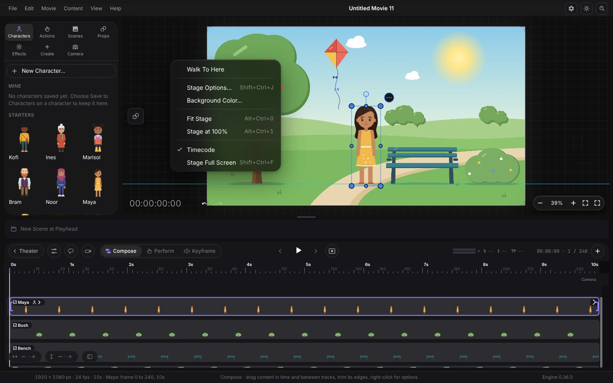

A character can walk across the Stage and stop where you choose. The starter action **Walk in place** is a walk with planted feet: each foot stays on the floor while it slides back, then lifts and swings through, so a body carried across the Stage at the right pace does not skate. The commands below move the character across the Stage and play that walk over the same frames. Select one character, put the Playhead over its block, and then:

- **Walk To Here:** with the character selected, right-click the spot on the Stage and choose **Walk To Here**. It is in the Stage's own menu on an empty spot, and in the content's menu when the spot is on scenery such as a backdrop. The character walks from where it stands at the Playhead to that spot, which is where its feet go, and then stands.
- **Walk In from Left** and **Walk In from Right**, in Content · **Walk** and in the character's right-click menu: from the Playhead the character walks in from off screen to where it stands now.
- **Walk Off Left** and **Walk Off Right**, in the same places: from the Playhead the character walks from where it stands to off screen.

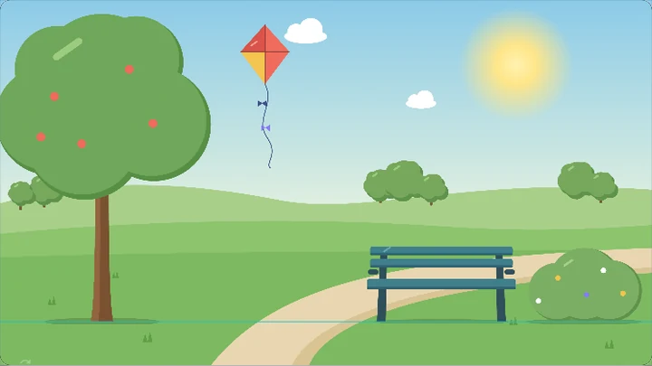

The walk writes move keys for exactly that stretch, plus the walk action over the same frames, at a pace that suits the length of the character's leg. The character turns to face the way it goes. It is one undo step, and it plays once, with a notice that says how many seconds it walks. The character's own move keys inside that stretch are replaced.

- **Where to right-click.** A block under the pointer takes the right-click as its own, and opens that block's menu. A picture that covers the whole frame, such as the background of a starter scene, is such a block, so inside the frame the Stage's own menu opens only where nothing is drawn. Right-click in the dimmed backstage around the frame, or hide that track while you place the walk, or use the four Walk In and Walk Off commands, which need no spot.
- **Refused.** A walk that would run past the end of the character's block on the Timeline, or of the movie, is refused with a sentence that tells you to lengthen the block or the movie or start earlier. Putting the Playhead off the character's block, or asking it to walk to where it already stands, is refused too.

**On iPad.** Select the character, then touch and hold the spot on the Stage: the character that was selected when your finger went down is the one that walks. The four Walk In and Walk Off commands work as they do elsewhere.

### Your own actions

- **Save Action...** makes an action from the character's own keys across the loop range, or across the whole block when none is set. Type a name. It takes the Move and Bones keys inside the range, adds a key at each end where the picture is, and is marked Loop when every channel ends where it starts. The keys it came from stay plain keys.
- **Delete Action...** removes one of the character's own actions. Where it was applied, the keys stay as plain keys and the strip goes.

### .fmact files

An action is a small text file you can keep, share and open in another movie.

- **Export Action...** asks which action and saves `[name].fmact`. A starter action exports too.
- **Import Action...** on Content · Actions, **Import** (Ctrl+I) with a `.fmact` among the files, or a drop on the window adds the action to the selected character, one undo step for each file. With no character selected, it says "Select a character, then import the action onto it."
- A file over 1 MB, or one that is not an action, is refused ("That is not an action file."), and so is one made by a newer FormMorpheus. An action file holds Move and Bones keys and nothing else.

## Starter scenes

File · **New from Starter Scene...** shows ten original scenes as cards, each with a small picture and its number of props: Corner Street, Park, Kitchen, Classroom, Stage, Office, Castle Hall, Space Station, Beach and Living Room. Click a card to pick it and press **Create** to take it, or double-click a card to take it at once. A new movie opens, named Untitled Movie, 1920 by 1080 at 24 frames a second and ten seconds long.

To add a scene to the movie that is open, choose Content · Add · **Add Starter Scene to This Movie...**. The same chooser opens, and its button reads **Add to Movie**. The scene's backdrop and props go behind everything already in the movie, each picture on its own track, fitted to the movie's size, in one undo step. The floor guide is taken only when the movie has none, and the scene's camera is left out so nothing already there moves.

- Each layer is a picture on **its own track**, the background at the bottom and every prop above it, each as long as the movie, so you can move, hide or replace any of them.
- The scene's **camera** is set at frame 0 and shows on the camera lane like any key.
- A **floor guide** is a horizontal guide line across the Stage where feet rest. It is shown and snapped to like any guide (Stage Options · Guides, **Show guides**), it is never exported, and you can drag it or remove it.
- The starter files themselves are never changed.

The props and rooms are drawn to the starter characters' scale: a character at half size is about as tall as an adult, so a bench, a table, a desk and a doorway are the size they should be beside it, every prop stands on the floor, and each background has depth.

A starter character added to this movie from the Characters panel stands on the floor guide at half its size, and each one has its own spot so two never land on each other: the first at mid-frame, then to the right, to the left, further right and further left. Without a floor guide, and for a character from Mine, it keeps its size and height and takes the same spots across the frame. In a movie of another size than 1920 by 1080 that has a floor guide, a starter character stands on the floor at the scene's size too.

## My scenes

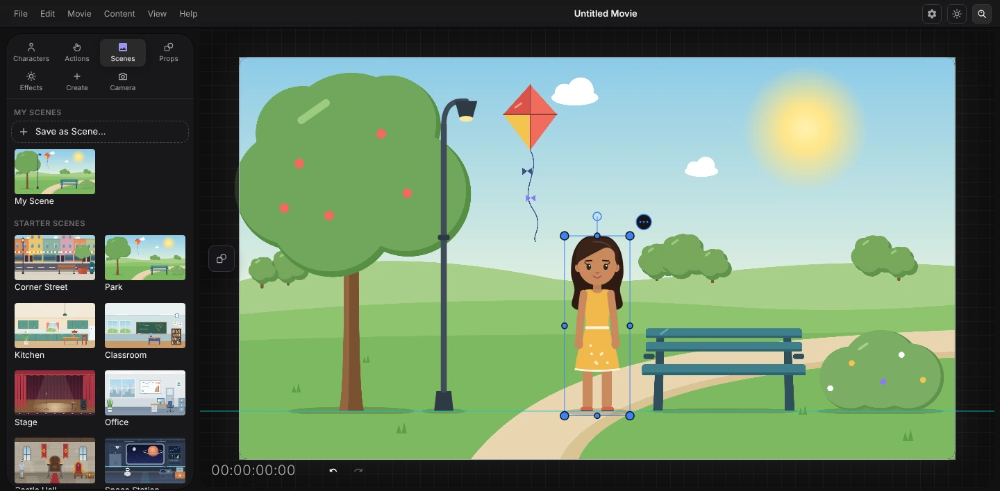

A scene of your own is scenery you built in one movie and keep, to lay behind any other movie the way a starter scene is. It is not the same as the scenes of the scene strip: those cut one movie into stretches (see Scenes on the Timeline).

### Save as Scene

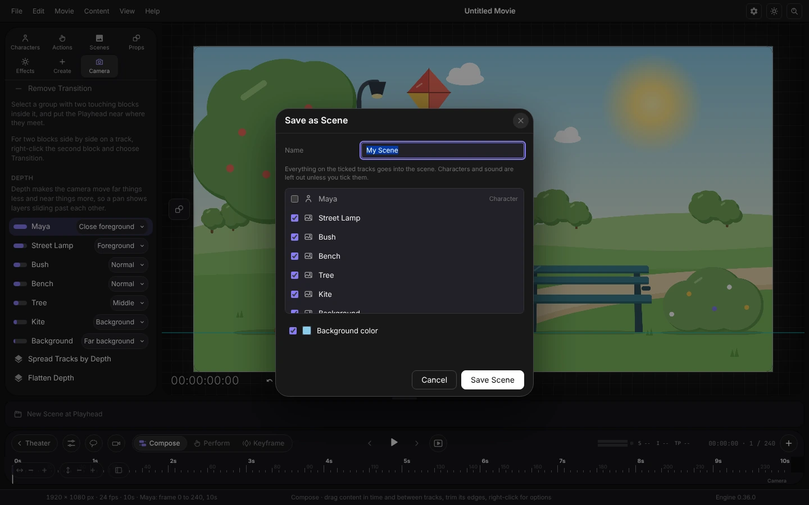

Choose Movie · **Save as Scene...**, or **Save as Scene...** at the top of the Scenes tab. It is greyed out until the movie has a block on some track. A card opens:

- **Name**: starts as the movie's name, or "My Scene" when the movie is still untitled, and is made free by adding a number ("My Scene 2") when it is taken.
- **The tracks**: every track that holds something, with its kind. Everything on a ticked track goes into the scene. Pictures, drawings, shapes and props start ticked; characters and sound start unticked, and you tick them if you want them.
- **Background color**: ticked when the movie's background is not white. It is kept as a track of its own.
- **Save Scene** is greyed out until a track or the background color is ticked and the name is not empty. When a scene of that name is already saved, a question offers **Replace** or **Keep Both**.

The scene keeps the movie's size and length, the floor guide if there is one, and a small picture of the movie at the Playhead for its tile. A link from a ticked block to something on a track you did not tick is cut.

### Use a scene of yours

In the Scenes tab, **My scenes** lists them, newest first, above the starter scenes. A click lays that scene behind everything in the open movie, in one undo step, **Add Scene**. A block that lasts the whole scene is stretched to the whole movie; the others keep their times and are cut at the movie's end. When the movie is another size, each track's blocks are scaled together to cover the frame, keeping their proportions. The floor guide is taken only when the movie has none.

- **Rename and delete.** The three dots on a tile, or a right-click on it, open **Rename...** and **Delete...**. Delete moves the scene to **Recently Deleted** on Home, where it can be restored for 30 days; a restore puts it back in My scenes.
- **Where they are kept.** Each scene is a `.fmo` file in the **Scenes** folder of your data folder (see The data folder), one file for each, and stays there after a restart. The engine serves them under `/api/scenes`. A scene is a copy: later changes in the movie it came from do not change it, and the scene is never changed when you lay it behind a movie.
- **The engine keeps them.** My scenes are read from and written through the engine, so when the engine is not running the tab says so instead of listing them.

**On iPad.** My scenes are kept in the **Scenes** folder of the FormMorpheus folder in the Files app, beside Characters. A deleted scene waits in Recently Deleted on Home by its name, and Restore puts it back in My scenes.

## Props

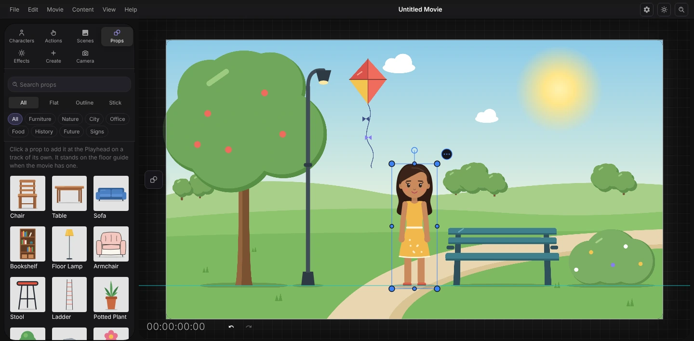

The **Props** tab of the Build panel (also Content · **Add Prop...**, which opens it with the search box ready) holds 49 ready-made objects: chairs, trees, street lamps, signs and more.

- **Styles**: **Flat** (flat color shapes), **Outline** (a hand-drawn outline) and **Stick** (thick simple lines). **All** shows every style.
- **Categories**: Furniture, Nature, City, Office, Food, History, Future and Signs, and **All**.
- **Search** matches a prop's name, its category and style, and a few words of its own: type "kitchen" to find the table and the chair.
- **Add one.** Click a tile. The prop is added at the Playhead on a new track at the top, in one undo step. It stands on the floor guide when the movie has one. A prop is one group of vector shapes, so it stays sharp at any zoom.
- **Move and resize.** A prop is an ordinary block: drag, scale, turn, key and hide it, and move its track to put it in front of or behind other things.

A prop that cannot be loaded says so in a notice and adds nothing.

## Scene effects

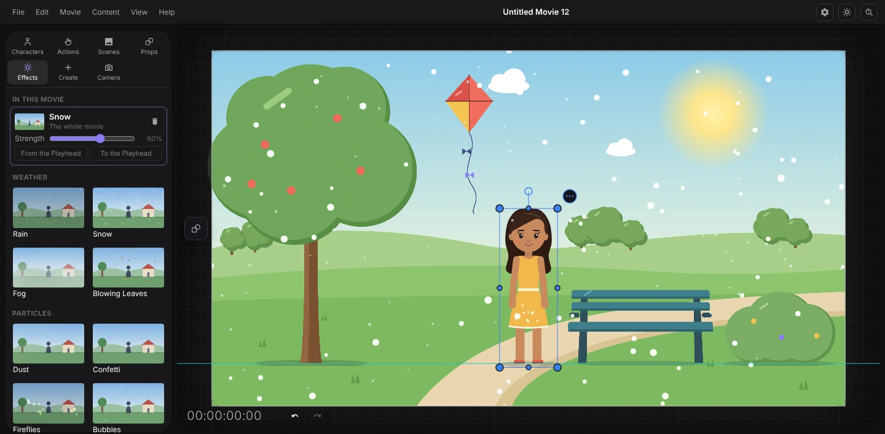

A scene effect is weather, particles or light drawn over the whole frame: choose Movie · **Scene Effects**, or open the **Effects** tab of the Build panel.

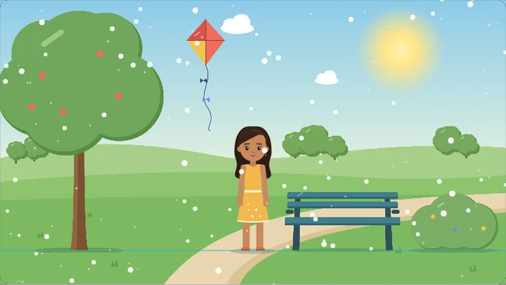

- **Weather**: Rain, Snow, Fog and Blowing Leaves.
- **Particles**: Dust, Confetti, Fireflies and Bubbles.
- **Light**: Sun Rays, Sunset Glow, Night, Spotlight and Lightning.

Click a tile to lay that effect over the whole movie. A notice says it is over the whole movie and that its strength, start and end are under Effects. The **In this movie** list at the top of the tab shows each effect with:

- **Strength**, a slider from 0 to 100 percent. Each effect starts at 60 percent, or 70 percent for Night, Spotlight and Lightning.
- **From the Playhead**, which starts the effect at the Playhead (and runs it to the end of the movie when the Playhead is already past its end), and **To the Playhead**, which ends it there. The card names the stretch it covers, which is "The whole movie" at first.
- **Remove**, the bin at the card's corner.

Each change is one undo step. You can lay several effects at once, for example Night with Fireflies. Movie · Scene Effects also has **Remove All Scene Effects**, which takes them all out in one step.

- **Where it is drawn.** Over the content and under the subtitles, on the Stage and through the same drawing that every export uses. It lies outside the camera, so a camera move does not shift it. It stays visible while you drag content on the Stage.
- **Scenes.** An effect moves, copies and deletes with the scene it is in (see Scenes on the Timeline).
- **Saved in the movie.** The effects are saved in the `.fmo`. A scene of yours does not keep them.

## Working with a vector app

A character can leave FormMorpheus as an SVG, be changed in a vector app such as FormPath, and come back with its animation. The vector app is only another program: FormMorpheus never starts or controls it.

### Send a character out

Select a character and choose File · Round Trips · **Character as SVG for Vector App...**.

- In the desktop app a folder dialog opens first. The file is written there, named after the character, and never replaces another file ("Name 2" when the name is taken). The character is then **linked** to the file, and the notice says so. Cancel in the dialog exports nothing.
- Elsewhere (in a browser, and on iPad) the file is downloaded or shared and the character is not linked; use Update from Source... when you bring it back.

The SVG has one `<g id="part name">` for each part, at the movie's size, with the art at rest. The parts are listed back to front exactly as the Stage draws them, so what is behind stays behind when the file is opened in a vector app. A part nests inside the group of the part it hangs from where that keeps the order; a part drawn far below its parent, hair behind the head for example, is written where it is drawn and names its parent in `data-fm-parent`. A part hidden in the movie is written hidden (`display:none`) and holds no other part. Shapes are written as paths, pictures as embedded PNG, and each part has a small magenta circle that marks its pivot (`pivot-` and the part's name); FormMorpheus removes it again when the file comes back. Text, video and sound parts are written as empty groups with their pivot, so their names survive, and the notice names them. Moves and keys are not written: they stay in FormMorpheus. Stroke alignment inside or outside, and trim path, have no form in SVG, so the stroke is centered and the outline whole.

In the vector app, change the art, keep **one group per part** and keep each part's name, then save the file where it is. You can hide a part or a shape there; it comes back hidden, and the file's paint order is kept.

### The source link and Update from Source...

A linked character follows its SVG file in the desktop app, and only when this computer made the link: by Character as SVG for Vector App..., by Update from Source... or Relink Source... with the file you chose, or by opening the SVG through the desktop app. A link that came in a movie, a saved character, a paste, a `.fmo` file or from an agent was made on another computer, so it is never followed by itself. Once for each movie in a session, a notice says "[file] was linked on another computer: choose Relink Source... to follow it." Choose **Relink Source...** and pick the file once, and from then on it is followed as usual. In a browser, links are never followed; Update from Source... still reads a file you pick.

While the FormMorpheus window has focus, it looks at the file about every two seconds, and at once when you come back to the window. When the file has changed, the character is read again as one undo step named **Update from Source**, and a notice says "Updated from [file]." with the names of any new or missing parts.

Parts are matched by name:

- **A part that is in both** takes the new art and the new pivot. It keeps its keys, parent, bones, move and turn, opacity, blend mode, timing and name, and the character keeps its actions and strips. A part that is a Flipbook, such as a mouth chart you drew in FormMorpheus, keeps its drawings.
- **A part that is new** in the file is added on top, on its own inner track, parented as the file says.
- **A part that is gone** from the file stays. It gets the red highlight, and when it is selected the status bar adds "Not in the source file". A highlight you gave the part yourself is kept while it is missing, and is put back when the part comes back; a part you highlighted another way while it was missing keeps that.
- **A part that comes back** to the file loses the red mark, since the red was only a sign that it was missing.
- **A hidden part** follows the file when the file changed it: a part you hid in the vector app arrives hidden, and is shown again when the file shows it. A part you hid in FormMorpheus stays as you set it, unless the file's own setting for that part changed since the file was last read.
- A part on a locked track refuses the update: "A part of this character is on a locked track. Unlock it, then update again."

An undo of an update is not put back by the next look at the file. Save the file again, choose Update from Source..., or Redo, to bring it back. If the file cannot be found, a notice says "Source file not found" once and the link is kept, so it is picked up when the file is back. Only SVG files up to 20 MB that are plain files, not links to other files, are read.

### The character's menu

On a selected character, the block's menu has:

- **Update from Source...** reads the character again from an SVG. In the desktop app it opens the system file dialog at the linked file and links the one you choose; elsewhere you pick the file and the link stays as it was.
- **Unlink Source** stops the character following its file (desktop). It is one undo step.
- **Relink Source...** links the character to an SVG file and reads it in one step (desktop app).

An SVG that the desktop app is handed by its path (Open With, or the command line) is linked when it opens. An SVG from Import or a drop has no path, so link it with Relink Source....

### On iPad

The iPad has no automatic check and no Unlink Source or Relink Source...: choose **Update from Source...** and pick the file again from Files. An SVG and a `.fmact` file both open from the Files app (a movie must be open first). The Characters library is the **Characters** folder beside your movies in the Files app (it is not kept in iCloud Drive). See "On iPad" in New in 0.18.0.

## Importing media

Use Import (Ctrl+I) or drop files on the window.

| Kind | Formats | Notes |
|---|---|---|
| Video | MP4, MOV, WebM and what the window can decode | frame-accurate; on the desktop, a video the window cannot decode (ProRes, some HEVC) is converted by ffmpeg, and without ffmpeg it is refused with the reason |
| Sound | WAV, MP3, AAC, FLAC, Ogg and Opus where decodable | waveform on the block |
| Pictures | PNG, JPEG, WebP, AVIF, BMP | placed as a picture block |
| SVG | SVG | opens as a character with a part for each group (see Characters) |
| Actions | `.fmact` | added to the selected character (see Actions) |
| Animated GIF | GIF | becomes a Flipbook, holds taken from the frame delays |
| TIFF | TIFF | decoded by the app itself |
| Fonts | TTF, OTF, WOFF, WOFF2 | ready in the Text card |
| Movies | `.fmo` | opens the movie |

Video blocks show a filmstrip. Sound shows its waveform. Choose **Separate audio and video** on a video block to split the sound onto its own block. **Volume** is on the block's menu, and a Volume lane lets you key it.

Sound is the clock during playback, so picture and sound stay together. A sound can sit a frame or two behind the Playhead readout because of the speaker delay.

### Coming from another animation app

- **Layered artwork** in a `.procreate` file opens as a Drawing with its layers, blend modes and groups.
- **A movie project from another app** cannot be opened: its file format is not public, so its timeline, keyframes and drawings cannot be read. Bring the movie over as what that app exports instead:
  - a **video** (MP4 or MOV, in H.264, HEVC or ProRes). Transparency is kept when the video has it. On the desktop, HEVC and ProRes that the window cannot play are converted by ffmpeg (see Engine formats).
  - a folder of **numbered PNG frames**, which becomes one Flipbook at the frame rate you choose.
  - an **animated GIF**, which becomes a Flipbook with its holds.
- Fonts and sound files come over as they are.

**From a scene-based animation app.** These apps keep a scene, its characters and its scenery inside their own project, which cannot be opened here. Export the movie from that app instead, as an **MP4 or WebM video** (a WebM in VP9 keeps its transparency), as an **animated GIF** (it becomes a Flipbook with its holds) or as **numbered PNG frames** (drop the folder and it becomes one Flipbook). Art you drew yourself opens directly: a **PNG** opens as a picture, a **PSD** opens as a Drawing with its layers, and an **SVG** opens as a character with a part for each group (see Characters). The characters and scenery that belong to the other app cannot be brought over: only what you drew yourself and the movie it exports.

## AI Voice

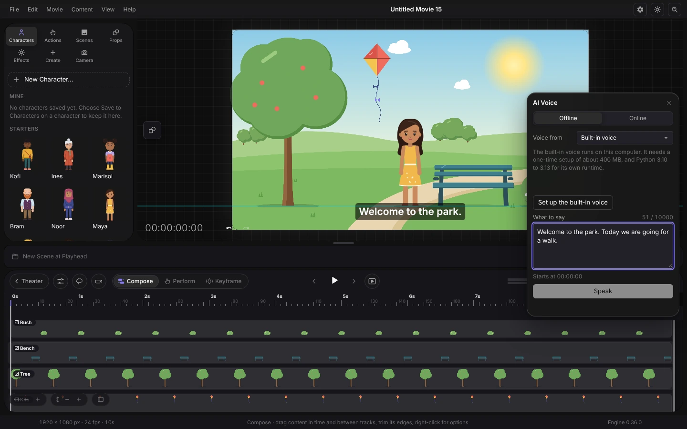

Type what to say, choose a voice and press **Speak**: the spoken sound lands on the Timeline at the Playhead, on a sound track, like any sound. Fades, pan, Lip-sync and export all work on it. Open the card from Content · Add · **AI Voice...**, or from More in the Create card, next to **Record sound...**. It has two tabs, **Offline** and **Online**.

### The built-in voice

On the **Offline** tab, **Voice from** · **Built-in voice** is Kokoro. It runs on this computer, with no account and no internet once it is set up.

- **Set up once.** Press the setup button in the card. FormMorpheus makes the voice its own runtime in the data folder, which needs Python 3.10 to 3.13 on your computer, and downloads the voice model, about 340 MB, checking the download before it is used. The card shows the step it is on and can cancel it. When no suitable Python is found, the card says so and nothing is installed.
- **Voices and speed.** There are 54 voices. American and British English are listed first. **Speed** goes from 0.5 to 2.
- **Remove.** The card can take the built-in voice away again, runtime and model together.

### A voice app on this computer (your own cloned voice)

On the **Offline** tab, **Voice from** · **Voice app on this computer** speaks through any voice app on this computer that answers the common speech API. This is how a cloned voice is used.

1. Clone the voice in that app, and start the app.
2. In the card, set its address. The default is `http://127.0.0.1:8080`. Only an address on this computer is accepted (`127.0.0.1`, `localhost` or `[::1]`).
3. Press **Check**. The card asks the app which models and voices it has.
4. Pick its model and voice, then **Speak**.

### An online voice

On the **Online** tab, an online voice (ElevenLabs) speaks with your own key. The key is kept in the system keychain, never in the settings file, and can be cleared again. The text can be up to 2000 characters. Your text is sent to that service only when you press **Speak** on this tab; nothing is sent on the Offline tab.

**On iPad.** AI Voice is there too. The **Online** tab works as above, with your own key kept in the iPad's Keychain. The built-in voice needs a computer, so the Offline tab says so; use **Voice app** with the address of a speech server on a computer on the same network, such as `http://192.168.1.20:8080` or `http://my-computer.local:8080`. Only an address on your own network is accepted, and the iPad asks once to allow access to the local network.

### Where the voice files are

The built-in voice lives in the **voice** folder of your data folder: its runtime in `voice/runtime` and its model in `voice/models`. The data folder is the one that holds the settings file: Preferences · General shows the settings and library folders, and `FORMMORPHEUS_DATA_DIR` moves it. A sound you have just spoken waits in `voice/out` until the window has placed it, and is removed within the hour if it never was. The sound you placed is part of the movie and is saved in the `.fmo` like any other sound.

### Subtitles and lip-sync

- **Lip-sync works today.** Choose **Lip-sync from Sound...** on the spoken sound's block and the mouth of a character takes its shape (see Lip-sync onto a character's mouth under Characters).
- **Subtitles come with the voice.** Each spoken sound remembers its words and the timing of each sentence inside the movie file, and an AI voice adds its subtitles by itself when it speaks. See Subtitles.

## Subtitles

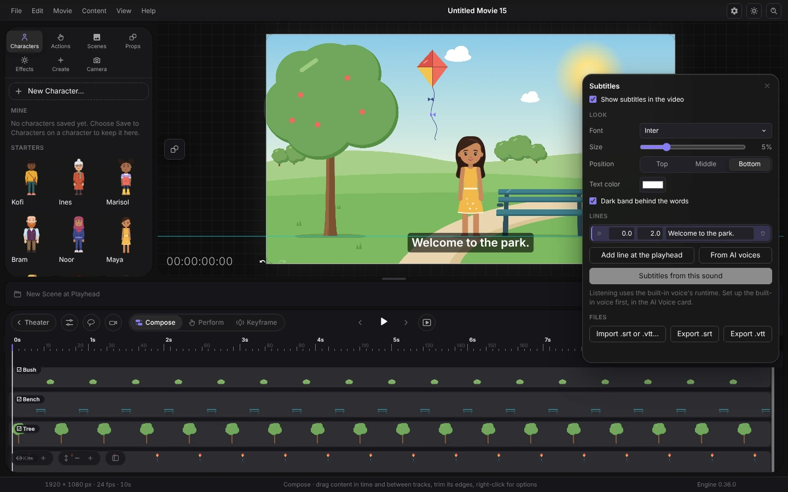

Subtitles are words drawn over the picture, on the Stage and in every export. Open the card from Content · Add · **Subtitles...**, or from More in the Create card. All the lines share one look. Every change you make in the card is one undo step.

### Show them in the video

Tick **Show subtitles in the video**. The line that covers the Playhead is drawn on the Stage, and every export carries the lines too, over the finished picture and after the camera, so a camera move never shifts them. Untick it and nothing is drawn, but the lines stay in the movie. They are saved in the `.fmo`.

### The look

One look serves all the lines:

- **Font**: the bundled fonts, the fonts you added and the fonts of the system.
- **Size**: from 2 to 15 percent of the movie's height. The default is 5.
- **Position**: **Top**, **Middle** or **Bottom**. Top and Bottom keep the words a little way in from the edge.
- **Text color**.
- **Dark band behind the words**: a dark rounded band behind each line. Without it the words get a dark outline, so they read on any picture.

Long lines wrap to fit inside the movie, to at most three lines.

### Lines from an AI voice

An AI voice adds its subtitles by itself when it speaks, one line for each sentence, timed to the sound's block on the Timeline. If you trim, move or change the speed of the block afterwards, press **From AI voices** to make the lines again for every sound an AI voice spoke earlier. Lines made again for a sound take the place of the lines it made before. Lines you typed or imported stay.

### Lines from a recording or a sound file

1. Select the block of the recording or the sound file on the Timeline. A video with sound works too.
2. Open the card and press **Subtitles from this sound**. Pick the **Language** first, or leave it on Detect.
3. The lines land in the card, timed to the block.

Listening runs on this computer. It uses the built-in voice's runtime, and its own model, Whisper base, which is a one-time download of about 80 MB that you start from the card with **Download the listening model**. The card shows the progress and can cancel it. Nothing you record or import is sent anywhere. Because it uses the built-in voice's runtime, set the built-in voice up first, in the AI Voice card; until then the card says so.

The model is kept in the **voice** folder of your data folder, in `voice/listen`, beside the built-in voice's own model. A sound of up to about two hours can be listened to in one go: split a longer block and listen to each part.

**On iPad.** Listening uses the iPad's own speech recognition, on the iPad only, so there is no model to download and nothing is sent to a network. The iPad asks for permission to use speech recognition the first time; if you refused it, the card says to allow it in the Settings app. A language the iPad cannot recognize on the device is refused. Cancelling from the card does not stop a listen that is already running; it ends by itself.

### Editing lines

Each line is a row with its **start** and **end** in seconds (type `12.5` or `1:02.5`) and its words. Change a field and press Enter, or leave it, to keep the change. The start stays before the end. The play button on a row moves the Playhead to the line, and the line under the Playhead is marked while you play.

- **Add line at the playhead** adds a two-second line there with its words ready to type over.
- The bin button on a row deletes that line.

### Subtitle files (.srt and .vtt)

- **Import .srt or .vtt...** reads a subtitle file of either kind. When the movie already has lines, the card asks whether to replace them or add the file's lines to them.
- **Export .srt** and **Export .vtt** write the lines, with their times in seconds, to a file named after the movie.

## Text

Add Text from Create. Type the words, and the Text card opens: **font** (the bundled fonts and any you imported), **size**, **weight**, **color** and **alignment**. Double-click the block to edit again. Each change is one undo step.

## Export

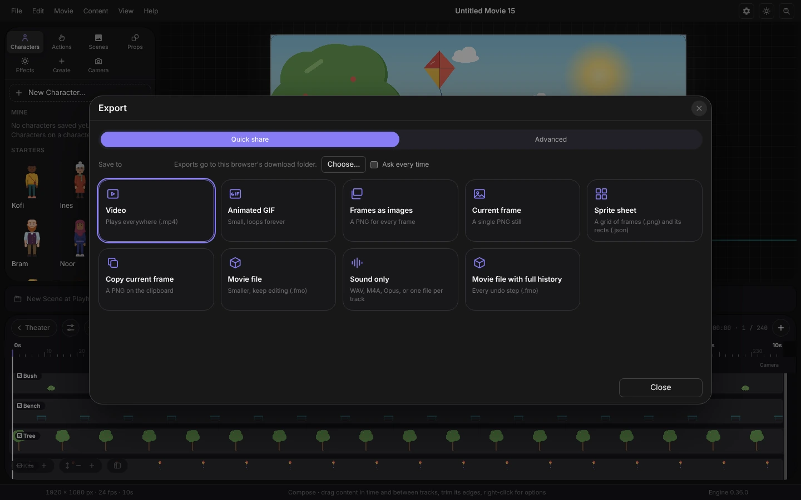

Open Export with Ctrl+E (File · Export). The dialog has **Quick share** tiles and **Advanced** options.

- **Quick share**: MP4 video, Animated GIF, PNG frames, Current frame, Movie file (.fmo).
- **Advanced**: movie size, 720p, 1080p, 4K, square or custom aspect-locked size; the whole movie or In and Out; one shot or ping pong; include sound; transparent background; quality from Low to Very high.

### Formats

| Format | What you get |
|---|---|
| MP4 video | H.264; sound as AAC where the browser can encode it, otherwise Opus with a warning |
| WebM video | VP9, with transparency if you ask for it |
| MOV video | the QuickTime container |
| HEVC as MOV or MP4 | made by the engine (see Engine formats) |
| Animated GIF | its own palette of 2 to 256 colors, Floyd-Steinberg or ordered dither, loop forever or not, exact or even frame timing, an alpha threshold, and an optional custom palette |
| PNG, JPG or WebP frames | one picture per frame, in a zip |
| PNG still | the current frame |
| Movie file | a `.fmo` to keep editing later |

### Engine formats

ProRes, ProRes 4444 (with alpha) and HEVC (in an MP4 or a MOV) cannot be encoded by the browser. The desktop engine makes them with **ffmpeg**, which it runs as a separate program. When there is no ffmpeg on your computer, those formats are listed as unavailable and the Export dialog says: "ProRes and HEVC need ffmpeg, which is not on this computer. Get it in Preferences, Video Tools." Click that notice, or open **Preferences, Video Tools**, and choose **Download ffmpeg**. It downloads ffmpeg 7.1.5 (about 12 MB) from the formai-binaries releases on GitHub into FormMorpheus's data folder, and every file is checked against its recorded SHA-256 before it is used. Its licence is LGPL-2.1-or-later. It is a separate program that FormMorpheus runs, not a part of FormMorpheus, and **Remove** takes it away again. That build makes ProRes, and HEVC where the computer has a hardware encoder FormMorpheus can use (on Windows, only some graphics cards); it has no MP3 or H.264 encoder. An ffmpeg you installed yourself is always used first, so for MP3, or HEVC on a computer without such an encoder, install your own. When you choose MP3 in Export sound and no ffmpeg with an MP3 encoder is found, the dialog says: "MP3 needs an ffmpeg with an MP3 encoder, which is not on this computer. The downloadable build has none, so install your own. See Preferences, Video Tools." Video Tools shows which ffmpeg is used and what it can encode. Nothing needs restarting. The window renders each frame, the engine encodes them, and the result appears on the Exports page.

### Where exports go

A **Save to** row under the Export card's tabs says where the next export goes.

- **This browser's download folder** is where an export goes until you choose otherwise.
- **Choose...** picks a folder, and exports go there. A file is never overwritten: when the name is taken, the new one becomes "name 2".
- **Ask every time** shows a save dialog for each export.
- **Forget folder** goes back to the download folder.
- In the desktop app, with no folder chosen, the row says exports are kept in the Exports folder of your data folder.

Where a browser or system has no folder chooser, the row says the browser's download folder is used and shows no buttons. The old Advanced checkbox "Choose a folder to save to" is this row now.

Every export is also kept in the engine's **Exports**, in the data folder, never overwritten (a second export of the same name sits beside the first). While an export runs you can cancel. Close the movie only after it ends.

## Home

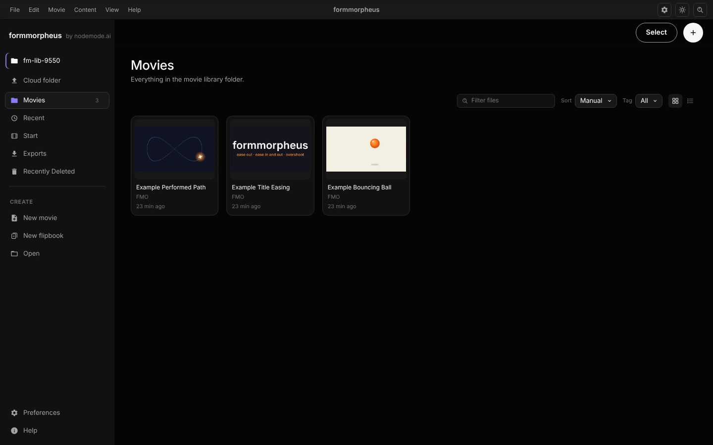

Theater is the name of the Home screen, where your movies are kept. The Theater button in the Timeline bar (a back chevron, named "Theater: back to your movies") takes you back to it from the movie you are working on, after saving it to the library. You can also open it with Shift+Ctrl+H or View · Theater. The left list has:

- **Start**: New movie, New flipbook, Open, and a short guide.
- **Recent**: the movies you opened lately.
- **Movies**: the whole library, as thumbnails or a list, with a filter box and sorting. Rename, duplicate and delete are on each item.
- **Exports**: everything you exported. Open, save a copy or delete.
- **Recently Deleted**: deleted movies, characters, scenes and exports stay here for 30 days. A character is marked with the person glyph, and restoring it puts it back in Characters; restoring a scene puts it back in My scenes. A movie and a character of the same name, deleted at the same moment, each keep their own place, and each restores as what it is. Restore one, delete it for good, or empty the list. Items past 30 days are swept away. If a name is taken, the restore gets a new one such as "name 2" and a notice tells you. The movie that is open cannot be deleted from Home: close it first.
- **Preferences** and **Help** at the foot.

## Preferences

Open with Ctrl+, (File or Edit menu). The pages:

- **General**: show Home at launch and when the last movie closes, What's New, Autosave, the settings and library folders, and Reset All Preferences.
- **Interface**: theme (29 themes, light and dark, or match the system), accent color and intensity, language, text size, interface scale, animations, notice time.
- **Timeline**: undo steps, scrub speed (Precise, Medium or Fast, which also sets how fast scrubbing the frame strip moves), two and three-finger tap for undo and redo, and ask before deleting.
- **Pen and Tablet**: the test pad, the pressure curve and what the pen's eraser end and buttons do (see Pen tablets).
- **Video Tools** (desktop only): which ffmpeg FormMorpheus uses and what it can encode, and Download ffmpeg and Remove for the family's build (see Engine formats).
- **Agents** (desktop only): whether outside agents may work on your movies, the address and command that connect a client, and a button that opens the terminal panel (see Agents).
- **Interface** (GPU): **GPU compositing** draws the Stage and exports on the graphics card. It is on when the card is faster and gives the same picture as the processor, and otherwise the processor does the work. Open the app with `?gpu=force` at the end of the address to skip the speed test.

### The data folder

FormMorpheus keeps what is yours in one **data folder**: the settings file, **Characters** (what you saved with Save to Characters), **Scenes** (what you saved with Save as Scene, one `.fmo` file each), **Exports**, **Recently Deleted**, **Brushes**, the **voice** folder and the movie library (in its **Library** folder, unless you chose another). It is not the folder you installed the app in. An update replaces the install folder, so your work is kept apart in a folder of your user account, where an update and a reinstall leave it alone.

Unless you move it, the data folder is named `formmorpheus` and sits here, for the installed app and for a source run (`./formmorpheus`) alike:

- **Windows**: `C:\Users\your name\AppData\Roaming\formmorpheus` (the `%APPDATA%` folder; AppData is hidden in Explorer, so paste the path into its address bar).
- **macOS**: `~/Library/Application Support/formmorpheus`. In Finder, choose Go · Go to Folder and paste it.
- **Linux**: `~/.local/share/formmorpheus`, or `formmorpheus` inside the folder `XDG_DATA_HOME` names when that is set.

Three things move it. The `FORMMORPHEUS_DATA_DIR` variable names another folder. A portable copy, started with `FORMMORPHEUS_PORTABLE=1` (or `--portable` on the desktop app), or an installed app with a file named `portable` or `portable.txt` beside it, keeps it in a `FormmorpheusData` folder beside the program. And the desktop app takes `--user-data-dir` and a folder.

To see where yours is, open Preferences · General: **Settings folder** shows the data folder, and **Library folder** shows where the movies are. Both are read-only text boxes with no open button, so select the path, copy it and paste it into your file manager. No command opens the data folder itself.

## Languages

The interface comes in 29 languages besides English: Spanish (and Mexican), Brazilian Portuguese, French (and Canadian), German, Italian, Dutch, Danish, Finnish, Norwegian, Swedish, Russian, Polish, Czech, Hungarian, Ukrainian, Turkish, Greek, Serbian (Latin), Simplified and Traditional Chinese, Japanese, Korean, Indonesian, Thai, Vietnamese, Arabic and Hindi. Pick one in Preferences · Interface · Language. Arabic switches the window to right to left. Names you give movies, layers and tracks stay as you wrote them. This manual is in English.

## Crash recovery

FormMorpheus keeps a recovery copy of the open movie while you work. Each window keeps its own copy and marks it alive every minute. After a crash, the next start offers only the copies of windows that stopped, never one that is still open in another window. Choose to restore it, or discard it. If a movie cannot be recovered, the app says so and keeps the copy for the next start. Edit · Restore Last Recovery Point is a different thing: it returns to an automatic point saved when you made a new edit after three or more undos. Edit · Recovery Points... lists every kept point (the last three, saved inside the movie) and restores any of them; Undo takes the restore back.

## Pen tablets

Any drawing tablet whose driver passes pen pressure to apps works in Draw and Paint: pressure, tilt, twist, the eraser end and the barrel buttons. Preferences · Pen and Tablet has a test pad that shows the live pressure, tilt, twist and rate your pen sends, a pressure curve (Soft, Normal, Firm, Linear or drag your own points), minimum and maximum pressure, smoothing, whether tilt shapes the brush, what the eraser end and each barrel button do (eyedropper, right-click menu, undo, pan, cycle tool or nothing), and palm rejection: while the pen is near the screen, fingers only pan and zoom. Save for this pen keeps the settings for that pen. If strokes show no pressure, the page says so: on Windows turn on Windows Ink in your tablet driver's settings, on macOS install your tablet's driver, and on Linux the system view may not pass pressure through.

## Pen Link: a tablet as a drawing tablet

Edit · Pen Link... turns a tablet with a pen and a web browser (an iPad, for example) into a pressure-sensitive drawing tablet for FormMorpheus over your local network. Turn it on, open the address it shows in the tablet's browser, and type the six-digit code (it lasts two minutes and allows five tries). The tablet shows your canvas and draws on it with the pen's pressure and tilt; its toolbar switches brush and eraser, undoes and redoes, and sets size and opacity. One tablet pairs at a time. Pen Link is off until you turn it on, it listens on your network only while it is on, and it serves nothing but its own page: the rest of FormMorpheus stays private to your computer. The connection is not encrypted, so use it on a network you trust.

## Brush files

Drop a brush file on the brush library, or use its import button, to see what is inside before it lands: a tree of the file's folders with a stroke preview of every brush. Untick what you do not want, choose a new library or the current one, and Import. Brush files with presets (.abr) bring their settings along, not just the tip picture: size, hardness, angle, roundness, spacing, size and angle jitter and what drives them (pressure, tilt, fade, direction), scatter and count, the texture from the file's patterns, color jitter, opacity and flow by pressure, noise and wet edges. A badge marks brushes with settings the brush engine can only approximate; its tooltip lists them. Tips only imports just the tip pictures.

## Agents

An outside agent is a program on your computer, such as Claude Code, Codex, Cursor or Antigravity, that works on your movies through MCP. FormMorpheus has an MCP server for them, and a terminal panel that can run these programs beside the Stage and the Timeline. Agents are for the desktop: on iPad there is no terminal panel and no Agents page in Preferences.

### What an agent can do

- **Reads** run at once: the version, the library folder and what your ffmpeg can encode (`get_context`), the movie list (`list_movies`), one movie's size, frame rate, length, tracks and content (`get_movie`), a movie's poster and preview (`get_movie_picture`), the saved characters in your Characters library (`list_characters`), which voices are ready on this computer and what each can speak with (`list_voices`), a movie's subtitles with their look and each line's start and end in seconds and frames (`list_subtitles`), and the other commands (`list_commands`). `run_command` also reads Recently Deleted, the Exports folder, stacks, fonts and the encoders your ffmpeg has.
- **Changes to the library** are made by `manage_movie`: create an empty movie, rename, duplicate, delete and restore. Delete moves a movie to Recently Deleted and never erases it. `run_command` also sets a movie's tags and its stack.
- **Five always ask first**: `export_movie` makes a file in the Exports folder, `import_file` brings a picture, video, sound or font file into a movie and saves it, `add_character` puts a copy of a saved character into a movie at the Playhead (or a frame the agent names), as Add to Movie in the Characters panel does, and saves the movie, and `add_voice` speaks a line with the built-in voice, a voice app on this computer or an online voice and puts the sound on the movie's Timeline at the Playhead (or a frame the agent names), as AI Voice does, and saves the movie, and `set_subtitles` changes a movie's subtitles (lines in seconds or the text of a .srt or .vtt file, replacing or adding to the lines, making lines from AI voices, showing or hiding them and their look), as the Subtitles card does, and saves the movie. All five need the FormMorpheus window open. You approve each one in it, and the window opens that movie to carry it out (`add_character`, `add_voice` and `set_subtitles` use the movie already open when the agent names none).

Agents work only on FormMorpheus's own data: your movie library, your Characters library (the Characters folder in the data folder), Recently Deleted, the Exports folder and the added fonts. None of these tools reads another file or folder on your computer, and an import takes only a file that is already inside the library folder. A program you run in the terminal panel can still do whatever it can do on its own, as in any terminal.

### Outside agents

Open Preferences (Ctrl+,) and choose **Agents**. **Outside agents** has three choices:

| Choice | What happens |
|---|---|
| Ask | The default. Reads work. A change to the library asks you in the FormMorpheus window first. With no window open, the change is refused and the agent is told to ask you to open FormMorpheus. |
| Allowed | Changes to the library go ahead without asking. An export or an import still asks each time. |
| Blocked | Every agent is refused, reads included, and so are the agents in the terminal panel. A question that was waiting is answered Deny. |

An agent you open yourself in the terminal panel is treated as yours: under Ask or Allowed it makes library changes without asking, and an export or an import still asks. Where the system has a keychain, FormMorpheus seals the choice with a key kept there. If the setting is changed from outside the app to allow agents, FormMorpheus ignores that change, asks again, and says so in Preferences.

### Connect a client

1. Start FormMorpheus: the app, or `./formmorpheus` from source. An export or an import needs the window to be open.
2. Open Preferences and choose **Agents**. **Connect a Client** shows two ways in.
3. A client that connects by address takes the **MCP address**, `http://127.0.0.1:<port>/mcp`. The engine listens on this computer only. The desktop app shows its own port there (it tries 9496 first). From source the engine's port is 9494, so the address is `http://127.0.0.1:9494/mcp`.
4. A client that starts its own server takes **Standard input and output**: the command `./formmorpheus mcp` (`formmorpheus.bat mcp` on Windows), run in the FormMorpheus folder. It passes each message on to the running engine, which it finds at `FORMMORPHEUS_MCP_URL` or `FORMMORPHEUS_PORT` when you set one, and otherwise on port 9494 or 9496. When no engine answers, it starts the engine of that FormMorpheus folder once; `FORMMORPHEUS_MCP_AUTOSTART=0` turns that off.

`./formmorpheus agents` sets up clients for you:

- `./formmorpheus agents install` writes FormMorpheus's entry for Claude Code (`.mcp.json`), Codex (`.codex/config.toml`) and Cursor (`.cursor/mcp.json`) in the FormMorpheus folder, and in the folder you ran it from when that is another one. It adds Antigravity's entry in `~/.gemini/config/mcp_config.json` and copies the `formmorpheus` skill into the skills folders these programs read. Entries for other servers are kept, and a file it changes is first copied beside itself with `.bak` and the date added to its name. `--dry-run` lists what it would do and writes nothing.
- `./formmorpheus agents sync` is for people who change FormMorpheus itself: it mirrors the skill pack to `.agents/skills` and writes `agents/manifest.json` from the server's code. `--check` changes nothing and exits with 1 when something is out of date.

After `install`, open the client in your folder, approve the `formmorpheus` server when it asks, and try "List my movies and export the newest as MP4". The export asks you in the window.

### The question in the window

When an agent needs your yes, a box opens in the middle of the FormMorpheus window. It names the agent (or says an outside agent), says what it asked to do, such as "rename the movie Intro to Opening", and reminds you that you can turn this off in Preferences, Agents. When several questions wait, it shows them one at a time.

- **Deny**: nothing is done. For the next 2 minutes the agent's requests that need your yes are refused without asking again. Escape also denies.
- **Allow once**: this one request goes ahead.
- **Always allow all outside agents**: sets Outside agents to Allowed. It is not offered for an export or an import, which always ask.

If nobody answers within 2 minutes, the question closes and nothing is done.

### The terminal panel

The terminal panel runs a shell and the agent programs beside the Stage and the Timeline.

- **Open it** from View · Terminal, or press Ctrl+`. Press Ctrl+` again, or the close button, to hide it; the programs in it keep running. View also has New Terminal and Claude Code (Shift+Ctrl+`).
- **Tabs**: the plus button opens a shell in your home folder, and the Claude Code button opens Claude Code. Codex, Cursor and Antigravity each get a button in the panel's head when they are on this computer, and a row in the More agents menu. Every program has its own tab. **Restart this tab** runs a program again, and **Close this tab** ends it. A tab whose program has ended is struck through.
- **Ask Claude Code**: type a request in the line at the bottom of the panel and press Enter. Claude Code opens in a tab with your words, the open movie's name, the frame and the ids of the selected content.
- **Move and resize**: the side button moves the panel to the right of the window, and back to the bottom. The right side needs a window at least 900 pixels wide. Drag the panel's edge to make it larger or smaller. FormMorpheus keeps its side, its size and whether it was open.
- **Installing**: Claude Code, Codex, Cursor and Antigravity must already be installed on your computer. FormMorpheus neither installs them nor signs you in to them. When one is missing, the panel says so and shows the line to run in your own terminal to install it. Sign in once there too; for Claude Code, run `claude` and type /login.
- **Where they work**: Claude Code, Codex and Cursor work in the `Agent` folder inside your settings folder (Preferences · General shows where it is); `FORMMORPHEUS_AGENT_DIR` picks another. Antigravity works in a folder of its own there. When a program is installed but not found, set its path in `FORMMORPHEUS_CLAUDE_BIN`, `FORMMORPHEUS_CODEX_BIN`, `FORMMORPHEUS_CURSOR_BIN` or `FORMMORPHEUS_ANTIGRAVITY_BIN`.

Closing FormMorpheus ends every tab.

## New in 0.38.0

**On iPad, AI Voice.** The Online tab works with your own key, kept in the iPad's Keychain. The built-in voice needs a computer; use Voice app with the address of a speech server on a computer on the same network, by number or by a `.local` name. Only an address on your own network is accepted, and the iPad asks once for local network access. See AI Voice.

**On iPad, listening for subtitles.** Subtitles from this sound uses the iPad's own speech recognition, on the iPad only, with no model to download. The iPad asks for permission the first time. See Subtitles.

**On iPad, My scenes.** Save as Scene, rename and delete work, scenes are kept in the Scenes folder of the FormMorpheus folder in Files, and a deleted scene waits in Recently Deleted. See My scenes.

**On iPad, Walk To Here.** Touch and hold the spot on the Stage with a character selected. See Walk.

**On iPad, easier to touch.** The Build panel, the scene strip, the AI Voice and Subtitles cards and Save as Scene have larger touch targets. Held upright, the Timeline's top row no longer overlaps, the AI Voice card scrolls and stands above the on-screen keyboard, and the Character Builder's view switch is larger.

**Not on iPad.** The built-in voice, Save to a chosen folder in Export, outside agents and the terminal panel, and Pen Link.

**In the Camera tab,** a track with no name shows the name of its first content in the Depth list.

## New in 0.37.0

**The Build panel has seven tabs.** Characters, Actions, Scenes, Props, Effects, Create and Camera, in two rows. See The Build panel.

**Character views.** A character made in the Character Builder can face the front, three-quarters, the side or the back, and be flipped, from a View row in the builder, from Content · Character View, from the content's right-click menu or from the Characters tab. Keyframes, actions and lip-sync stay. The side view is a near profile, and the starter actions are drawn for the front view. See Character views.

**Props.** A Props tab with 49 objects in three styles and eight categories, with a search box. A click adds one at the Playhead on a new track, standing on the floor guide when there is one. See Props.

**Five more starter scenes.** Office, Castle Hall, Space Station, Beach and Living Room make ten. A starter character added to a movie of another size than 1920 by 1080 now stands at the scene's size. See Starter scenes.

**My scenes.** Save as Scene... keeps the tracks you tick as a scene of your own in the Scenes folder of the data folder, and a click on it in the Scenes tab lays it behind any movie. Rename and delete are on the tile; a deleted scene waits in Recently Deleted. See My scenes.

**Scene effects.** Rain, Snow, Fog, Blowing Leaves, Dust, Confetti, Fireflies, Bubbles, Sun Rays, Sunset Glow, Night, Spotlight and Lightning, laid over the whole movie from the Effects tab, each with a strength and a start and end. They stay visible while you drag content on the Stage. See Scene effects.

**Camera moves and transitions.** The Camera tab has Push In, Pull Out, Pan Left, Pan Right, Tilt Up, Tilt Down, Push In on Selection, Whip Pan, Slow Drift, Shake and Reset Camera Here, with a length of 0.5, 1, 2 or 4 seconds. A click writes camera keys from the Playhead and plays once. The transitions are tiles with moving diagrams. See Camera.

**Scenes on the Timeline.** A strip above the Timeline cuts the movie into named scenes: go to one, rename, focus and loop in it, duplicate, move earlier or later, add an empty scene, or delete a cut or a scene with its content. A scene has no tracks of its own and cannot be dragged to reorder. See Scenes on the Timeline.

**Depth made easy.** A Depth step for each track (Far background to Close foreground) in the track's menu, and Spread Tracks by Depth and Flatten Depth in the Camera tab and the Movie menu. The camera moves far things less. See Depth.

**Walk.** Walk in place is a walk with planted feet. With one character selected, right-click the Stage and choose Walk To Here, or use Content · Walk for Walk In from Left, Walk In from Right, Walk Off Left and Walk Off Right. See Walk.

**In the Characters panel,** a character you made in the builder and saved has Edit in Character Builder.

**Fixed.** A double-click picks a character's part where it is drawn, and now finds thin parts such as lower legs, forearms and brows. Update from Source brings in a part hidden in the vector app as hidden, and shows it again when the file shows it; a part you hid in FormMorpheus stays as you set it unless the file changed. Scene effects and subtitles stay visible while content is dragged on the Stage.

## New in 0.36.0

**The Build panel.** View · Build Panel opens a panel beside the Stage with Characters, Actions, Scenes, Create and Camera. A click on a character adds it at the Playhead, a click on an action applies it to the selected character, and a click on a scene adds it behind everything in the movie. See The Build panel.

**The modes and Preview.** Compose, Perform and Keyframe are a compact switch in the Timeline's top row, after the Theater and Camera mode buttons, and on a narrow window only the icons show. A Preview button plays the movie from the first frame, full screen. See Modes.

**Where exports go.** A Save to row in the Export card sends exports to this browser's download folder, to a folder you choose, or asks each time. It replaces the Advanced checkbox "Choose a folder to save to". See Where exports go.

## New in 0.35.0

**27 languages.** AI Voice, Subtitles and the menus and notices added since 0.31.0 are now in all 27 languages the app has.

**Explained.** The manual says where the data folder is on Windows, macOS and Linux, has a walkthrough, Make a character talk, and explains Frame A and Frame B in the Character Builder, starting a new character from an existing one through an SVG, what Theater is, and how track order decides what is in front.

## New in 0.34.0

**The selection box.** On the Stage the box hugs what is drawn: a character's box is the character, and a drawing's box is its ink. A click picks what is under the pointer, and a drag that starts on the selected content moves it without selecting something else. Side nodes on a character or group scale it whole and keep its proportions. See Compose.

**Right-click on content.** The Stage opens that content's menu, with Apply Action... for a character and an Arrange group (Bring to Front, Bring Forward, Send Backward, Send to Back).

**Actions.** An applied or swapped action plays once from its start and the Playhead goes back, with a notice "{action} applied to {character}". Drag either edge of an action's strip on a selected character block to make it longer or shorter. See Actions.

**The Character Builder.** Mine lists the characters you saved, a saved one shows there at once, and Add to Movie closes the builder.

**Starter scenes.** Content · Add · Add Starter Scene to This Movie... adds a scene's backdrop and props behind everything in the open movie. In the chooser a click picks a card and the button takes it; a double click takes it at once. See Starter scenes.

**Character as SVG for Vector App.** The file lists the parts back to front as the Stage draws them, hidden parts are written hidden, and importing keeps that order and keeps parts and shapes hidden in the vector app hidden. See Working with a vector app.

**Looks.** Block names on the Timeline are readable in the light themes, the Theater button says where it goes, Movie settings is not cut off, and menus never run taller than the window.

## New in 0.33.0

**Subtitles.** Content · Add · Subtitles..., or More in the Create card, opens a card. Tick Show subtitles in the video and the lines are drawn on the Stage and in every export. One look serves all the lines: font, size, position (top, middle or bottom), text color and a dark band behind the words. See Subtitles.

**From AI voices.** AI voices add their subtitles by themselves when they speak, and From AI voices makes them again for sounds spoken earlier.

**From a recording or a sound file.** Select its block on the Timeline and press Subtitles from this sound. Listening runs on this computer in the built-in voice's runtime with a model of its own, a one-time download from the card, and nothing is sent anywhere.

**Editing and files.** Lines can be edited in the card (text, start, end), added at the Playhead and deleted, each one an undo step. Import a .srt or .vtt file, and export the lines as either.

**Agents.** `list_subtitles` reads a movie's subtitles, and `set_subtitles` changes them after you say yes in the window.

**Not yet.** The card's labels in languages other than English.

## New in 0.32.0

**AI Voice.** Content · Add · AI Voice..., or More in the Create card, opens a card where you type what to say, choose a voice and press Speak. The spoken sound lands on the Timeline at the Playhead on a sound track, so fades, pan, Lip-sync onto a character's mouth and export work on it. See AI Voice.

**Three voices.** The Offline tab's **Built-in voice** is Kokoro, which runs on this computer with no account and no internet after a one-time setup (Python 3.10 to 3.13 and a model of about 340 MB), with 54 voices and a speed from 0.5 to 2. **Voice app on this computer** speaks through a voice app that answers the common speech API on this computer, which is how a cloned voice is used. The Online tab speaks with your own key, kept in the system keychain, and sends your text only when you press Speak.

**Words kept with the sound.** Each spoken sound remembers its words and the timing of each sentence inside the movie file, for the subtitles coming in the next version.

**Agents.** `list_voices` reads which voices are ready, and `add_voice` speaks a line onto a movie's Timeline after you say yes in the window.

**Not yet.** Subtitles in the video, and the card's labels in languages other than English.

## New in 0.31.0

**The Character Builder.** Make a character by choosing instead of drawing: Build a character in the Characters panel, or Content · Character Builder.... Start from a preset, then shape it on a live preview: seven kinds (Human, Robot, Alien, Monster, Fox, Dino and Sprout), skin, height, build, shoulders, head size and frame, the face, 16 hair styles and 16 outfits with a color for each piece. Randomize makes a new look and Reset goes back. Add to Movie puts it in the movie in one undo step, and Save to Characters keeps it with its recipe. See The Character Builder under Characters.

**Built characters.** A built character is a real character with a part for every piece: hip, body, neck, head, eyes, brows, mouth, upper arm, forearm and hand, thigh, shin and foot on each side, the hair in three parts and the outfit's own pieces, each following the part it hangs from with a pivot at its joint. A fox and a dino have a tail of their own on the hip. Its mouth is a mouth chart of the eight shapes drawn for its face, so Lip-sync from Sound works on it at once. Edit in Character Builder... on its menu opens it again, and Apply changes it in one undo step, keeping its keys, actions and lip-sync; a piece the new look no longer draws is hidden with its keys and comes back when it returns.

**26 starter characters.** The Characters panel's Starter list holds the five drawn ones and 21 built ones: Maya, Ingrid, Zuri, Mei, Rosa, Amara, Jade, Leo, Karl, Arjun, Finn, Otto, Dev, Walt, Sami, Bolt, Zib, Moss, Pip, Rex and Sprig, each row with its figure and what it is. Open in Character Builder starts the builder from a built one. They stand on a starter scene's floor like the drawn ones.

**Starter actions.** Twelve now: Run, Dance, Talk and Cheer join the first eight. On a built character the starters use its forearms, shins, feet, eyes, brows, hair, shadow and tail: Idle breathes and blinks, Walk in place lifts each leg, Wave Hello waves from the elbow and wrist, Jump crouches and reaches, Sit keeps the feet on the floor. Talk steps the mouth through its shapes, Run, Dance, Cheer, Wave Hello and Jump open it, and the looping ones ease in and out at the ends of their span. On the drawn starters and your own SVG characters the actions are as before.

**Placement.** Characters added to a movie without a floor take spots spaced for their full size, so they stand side by side instead of overlapping.

**In your language.** The Character Builder, the starter characters, their tags and the new actions are in all 30 languages, with Mexican Spanish and Canadian French words for the clothes, and the builder lays out right to left in Arabic.

## New in 0.25.0

**Characters.** An SVG with one group per body part opens as a character, with parts, pivots and parenting. Make Character does the same for a Group you built. View · Characters lists five starter characters and the ones you save with Save to Characters; Add to Movie puts an independent copy in any movie, each character at its own spot across the frame. Lip-sync from Sound... can fill a character's mouth, and Use as Mouth Chart... gives any character a mouth from an SVG of the eight shapes. Double-click a character to pick one part and move, turn or key it alone. Recently Deleted keeps deleted characters, and outside agents have `list_characters` and `add_character`. An SVG with no groups opens as one part for each run of loose shapes, a group hidden in the file (hidden or not displayed) arrives hidden with its art, and `preserveAspectRatio` is honoured.

**Actions.** Apply, swap, clear and save named motions on a character, shown as strips on its block. Eight starter actions ship (Idle, Nod, Shake head, Wave Hello, Point, Walk in place, Jump and Sit), they fit each character's size and facing, and an action travels as a `.fmact` file.

**Starter scenes.** File · New from Starter Scene... opens one of five original scenes (Corner Street, Park, Kitchen, Classroom and Stage) as a new movie, with a floor guide. The props are drawn to the starter characters' scale, and each starter character you add stands at its own spot on the floor.

**Vector app.** File · Round Trips · Character as SVG for Vector App... sends a character out and links it. When the file is saved in the vector app, the character updates by part name and keeps its animation, in the desktop app and for a link this computer made; a link that came in a movie from elsewhere waits for Relink Source... once. Update from Source..., Unlink Source and Relink Source... are on the character's menu.

**On iPad.** The iPad keeps a Characters library in the Files app, and SVG and `.fmact` files open from Files. The iPad app is a beta you build yourself; it was built and run on an iPad Pro 13-inch (M5) with Apple Pencil Pro on iPadOS 26.3.

**The manual.** Transitions has its own section under Compose, and Coming from another animation app covers scene-based apps.

## New in 0.18.0

**A new icon.** FormMorpheus has a new app icon on the desktop, in the browser tab and in About.

**On iPad.** The iPad app is a beta that you build yourself on a Mac with Xcode and an Apple developer account (a free one works, but then it needs the iCloud step in the build guide, and the library stays on the iPad instead of iCloud Drive); the steps are in [Build FormMorpheus for iPad](https://github.com/nodemode-dev/formmorpheus/blob/main/docs/ios/BUILD.md). On iPad, movies live in the FormMorpheus folder of the Files app, and movies, pictures, video and sound open from Files (a movie from elsewhere is copied into your Library, so the original is never changed). The menu bar and keyboard shortcuts work with a hardware keyboard. Apple Pencil Pro squeeze and double tap can switch to the eraser, show the color picker, undo, or follow the choice made in the iPad Settings app, and barrel roll turns brushes that follow the Pencil's angle. Draw with Pencil only keeps fingers for panning, zooming and gestures. Export uses the iPad's own video encoders, including HEVC with transparency where the iPad supports it. If iPadOS closes the app's drawing area to free memory, your latest snapshot opens again. Help > About FormMorpheus > Diagnostics checks the iPad and saves a report to send with any problem.

**On iPad, from 0.23.0.** The iPad app runs on iPadOS 16.4 or later; squeeze, barrel roll and the Pencil haptics need iPadOS 17.5. A ProRes video (422 or 4444) now imports: the iPad converts it with its own encoders, ProRes 4444 with transparency to HEVC with transparency and everything else to H.264, which takes a moment for a long clip. HEVC with transparency imports as it is. Whether the transparency shows depends on the iPad's video decoder: if the first frame comes out with none, a notice says so. A video the iPad cannot read at all, a video over 2 GB, and sounds or pictures the iPad cannot decode are still refused with the reason. On Home, the second place under Library is iCloud Drive: tap it to keep the library in iCloud Drive > FormMorpheus (On This iPad takes it back). Nothing is copied when you switch, so use Copy to iCloud Drive in the Theater to bring movies across. Movies saved there appear on your other iPads signed in to the same Apple Account; one that has not arrived yet downloads when you open it, or shows once iCloud has brought it over. When iCloud Drive is off or no one is signed in, Home says so.

## New in 0.17.2

**Brushes.** Bristle, oil and knife brushes keep their streaks along the stroke in every direction and around curves, with highlights that follow them. Paints no longer show a repeating pattern in their body, and Round paint and Gouache break up at a dry edge.

**Bringing work in.** Choose several numbered pictures, or drop a folder of them, and import them as one Flipbook at the frame rate you type. A project file from another animation app is explained: its timeline cannot be read, but any pictures and sounds found inside go to the media bin, and the message says how to export your work from that app.

**Pens and tablets.** A stroke is kept when the system interrupts the pen, a pen resting still never opens the color picker mid-stroke, and a palm on the screen gives way to the pen. A tablet that reports pressure as a mouse can turn on Use pressure from the mouse in Pen and Tablet. Pen Link lifts cleanly when the tablet's page is hidden or the connection drops.

**Systems.** On a system that cannot encode a video or sound format itself, export hands it to the engine. Text spacing, animated pictures and previews have fallbacks on older systems, and the graphics card path falls back to drawing without it when a movie is too large for it or the card resets. If the system is too old to run FormMorpheus at all, one message says what it needs.

## New in 0.17.1

**Brushes.** Chrome reads as polished metal, Rough hatch lays real diagonal hatching that keeps its angle on any stroke, and Sumi ends cleanly. Charcoal, chalk and pastel sticks shade wide whichever way the pen leans, and Grain airbrush starts as a soft cloud. Bristle brushes fray at the end of a tilted stroke, knives end in a rounded point, and the opaque paints widen with pressure and break up at a dry edge. Watercolor leaves no tint on bare paper and beads only where the pen really stops.

**Editing.** Copy blocks from one movie and paste them into another, with their pictures and sounds. Trimming several selected blocks trims them all at once. Ungroup waits until one group is selected.

**Help and export.** The manual in Help can show what each version added, and its search highlights matches and steps through them with Enter. The Export window names any font that is missing and offers to fix it.

## New in 0.17.0

**Groups.** Expand a Group on the Timeline to see its own tracks. Drag blocks into and out of it, and Create adds content inside the open Group.

**Timeline and Stage.** Hold the toolbar between the Stage and the Timeline, or the strip just above the ruler, and drag to resize them. H hides the selected content. Hold a blank part of a lane and drag to move the track. A one-finger drag on an empty lane pans. The track menu has Cut, Copy, Duplicate and Paste tiles. Blocks carry their mask kind as a label, video blocks show film edges, and Text blocks show their text. The Stage timecode reads hours, minutes, seconds and frames, and Enter duration takes hours, minutes and seconds. Changing the frame rate keeps every frame on its frame by default (the movie plays faster or slower); Keep timing moves blocks and keys so each keeps its length in seconds.

**Keyframes.** Ease in now starts slowly and Ease out ends slowly, as their names say (movies made earlier play exactly as before; only the labels moved). Reverse keyframes mirrors around the content or the selection, so lanes stay in step. Edit anchor never moves the picture. Warp meshes gain Add row and Add column. Swipe a red row left in the Action card to clear it.

**Draw and Paint.** Create · Drawing and Create · Flipbook open Draw and Paint (Preferences can keep you on the Timeline). Size and opacity markers start empty, Color history keeps ten colors and shows at the top of Palettes, and the brush panel has a search button. ColorDrop fills under soft stroke edges. Hold a second finger to make a square or circle selection. Crop and Resample show their progress.

**Brushes.** Oil and bristle brushes no longer show blocks or seams at light pressure, knives smear the paint below, glaze builds a film, watercolor bleeds into a wet wash and settles unevenly, inks pool and taper, gouache and acrylic show grain and a dry edge, texture brushes are continuous, spray is a mist, color pencil reaches full color, charcoal and pencil shade wide when tilted, and Charcoal roll, Marker roll and Calligraphy roll turn with the pen. Hold a brush to open its menu.

**Import, fonts and sharing.** Open `.procreate` artwork as a layered Drawing. An import goes onto the highlighted track when it fits. Fonts installed once are in every movie (Fonts library); a movie whose font is missing asks to replace or keep it; `.ttc` collections bring every face. Share in the Theater offers the movie file, a video or frames, and frames can be saved into a folder.

**Help.** Help links to the handbook, community and video tutorials on the web, and recovery points can be shared.

## New in 0.16.0

**Theater.** Choose Gallery or Library layout in Preferences. Right-click a movie for Info... (size, length, frame rate, tracks, file size, dates) and Tags...; filter the Theater by tag. A cloud folder you keep in sync can receive copies (Copy to Cloud). A movie reopens at the frame where you left it, and its poster is that frame. View can hide the menu bar and the status bar.

**Timeline.** Alt-click a block's checkbox to hide just that block. Right-click a track's header or empty lane for the track menu. J, K and L shuttle back, stop and forward. Hold Space and drag to pan. The ruler shows bold seconds and frame numbers together, and dragging it scrubs (hold Alt to scale time). Flipbook blocks show their drawings on paper cells with a color chip. Movie settings · Timeline has an Editing group for snapping and sound previews.

**Keyframes, Stage and camera.** Click a key in an expanded lane to type its value; drag several keys together; K adds a key, Shift+K and Alt+K step between keys, 1 to 4 set the easing. Pictures read 100 percent at their fit. Several selected blocks share one box in Compose. Moving the anchor keeps the picture still. The camera has shake, follow and a parallax depth per track, and Perform shows a count-in before a take.

**Effects and titles.** New effects: Ripple, Halftone, Outline, Gradient Map, Glitch, Kaleidoscope, Hue Range Shift, Sharpen Radius and Gaussian Blur X Y; each effect in a stack has its own on and off switch, and Color Correction's curve points can be keyed. Adjustment blocks work inside groups. Titles have presets, a gradient fill, glow, text on an arc, wave or circle, and animators that act on a range of letters, words or lines. Motion blur covers opacity, time remap and text.

**Drawing.** Watercolor pools where the pen rests, darkens at its rim and bleeds into a wet neighbour; oil frays at stroke ends and widens with tilt; chalk is grainier. Brush Studio has pressure and tilt popovers per setting, Position scatter beside rotation Scatter, a reset point and a Pressure and Smoothing card (double-click a brush). The canvas shows the brush outline as you hover. The Layers panel has swipe, two-finger and pinch gestures, the color disc cycles white, black and grey on a double-click, the Flipbook strip tears off into a Mini Flipbook, and a Libraries screen shows every brush library. Long painting sessions stall less.

**Export and sound.** Every export shows frames done, time elapsed and time left, with Cancel, and a chip keeps showing it when the dialog is closed. New: MP3 through your ffmpeg, size targets for HEVC and ProRes, chapters from markers, a sprite sheet, copy the current frame, and 480p. Safe areas are clearly drawn, with 1:1 and 4:5 frames. Meters read loudness and true peak, a ducked track shows its gain reduction, and View · Add Markers on Beats marks a sound's beats. The media bin can make proxies of large videos for smooth editing; exports always use the originals.

**Pens and Pen Link.** Pen Link shows a QR code of its address, limits pairing tries per device, and tells the tablet to open Draw and Paint when it is closed; its page follows the tablet's language. Brush files can keep their own pixel sizes, and a dual tip, zip-compressed patterns and 32-bit tips are read.

## New in 0.15.0

**Your movies save themselves.** A new movie is in the Theater the moment you make it, and every change is saved as you work. Leaving a movie never asks; its poster is the frame under the Playhead. Ctrl+S saves at once, and Duplicate as... makes a copy.

**Pens and tablets.** Pressure, tilt, eraser end and barrel buttons from drawing tablets, a Pen and Tablet page with a test pad and a pressure curve, palm rejection, and Pen Link to draw from a tablet's browser. See the sections above.

**Brushes.** Oil brushes paint with separate hairs that streak and pick up the paint below; watercolor pools and darkens at its edges, bleeds into a wash that is still wet, and no longer runs dry on a long stroke; pencils darken with pressure and shade wide when tilted. Brush files bring their presets (see Brush files).

**Draw and Paint.** Hold at the end of a stroke to snap it to a line, arc, ellipse, rectangle or polygon (QuickShape), Shift+click for a straight line, hold the pen or mouse still to pick a color, the size bubble previews the stroke, a grouped blend list previews as you go, ColorDrop can keep filling, Select starts on Automatic, and the Flipbook strip is simpler, with the rest under More.

**Timeline.** Track headers with names, hide, lock, mute and solo (View · Track Headers); dragging a block shows where it will land and makes a new track between lanes; the block menu is grouped; the ruler counts seconds when zoomed out; double-click steps the zoom; Z zooms to the selection and Shift+Z to the loop range.

**Keyframes and Perform.** Compose edits the base transform only, scale can flip past zero, the Action card has Move and Filter, the parameter card stays open while you drag, snapping waits for Shift, a readout shows position, scale and angle while dragging, and Perform has Retake (Shift+R), a pre-roll and a punch range, and keys to rotate (R) and scale (S) with a mouse.

**Look.** Popovers and dialogs grow from their button, menus are glass, the Create menu is a card of tiles, the Theater is a poster wall, and Movie settings keeps its tabs at the bottom.

## New in 0.14.0

**Effects.** The Action menu's Live Filters now include Drop Shadow, Glow, Color Correction (levels, curves, color balance, exposure, temperature and tint, vibrance), Vignette, Pixelate, Directional Blur, Radial Blur (drag its center on the Stage), Motion Blur, Chroma Key (pick the key color on the Stage, view the matte) and Luma Key. Every setting can be keyed. Movie settings · Timeline turns on motion blur for the whole movie.

**Titles, shapes and solids.** Select words in a text and use Edit Style to give them their own font, size, color and outline; the Effects tab adds a shadow and a background box, and the Animate tab builds text on and off by letter, word or line (fade, slide, scale, rotate, blur, typewriter). Create · Shape draws rectangles, ellipses, polygons, stars, lines and pen paths with gradient fills, dashed strokes and an animated trim; Create · Solid fills the movie with a color; an Adjustment block applies its filters to everything below it.

**Sound.** The Sound effects card adds EQ, compressor, reverb, noise gate and de-esser to a block or a track, a track can duck under another, the Timeline shows level meters, and Export · Sound only writes WAV, M4A or Opus, or one file per track.

**Export and media.** Presets for common shapes and limits (and your own), a target bitrate or file size with a size estimate, a frame rate and scale for the export, fit or fill into another shape, animated WebP and APNG, a layered PSD of the current frame and frame zips named by timecode. Every export, including movies with video, now renders in the background. View · Media Bin lists the movie's pictures, video, sound and fonts, where each is used, and replaces or relinks them.

**Drawing.** Painting now runs off the main thread. Wet brushes drag paint along the stroke, pencils and charcoal respond to light pressure, Materials can add shine (gloss, metal, light angle), and palettes import and export (including from a picture). In a Flipbook, Timing sets shooting on ones to fours, Exposure Sheet shows frames, holds, sound and notes in a grid, and Underlay puts a picture or video under the drawing as a reference.

**Keyboard.** A skip link is the first Tab stop on Home, in the editor and in Draw and Paint.

## New in 0.13.0

**Brush Studio.** Right-click a brush and choose Edit Brush, or New brush in the brush panel's menu. A live drawing pad sits beside the brush's sections: Stroke path, Taper, Shape, Grain, Rendering, Wet mix, Color dynamics, Dynamics, Pencil, Pressure curves, Properties, Materials and About this brush. Every slider has a number, double-click a label to reset it, Undo last change and Reset brush step back, and a built-in brush is saved as a copy. Shape and Grain have libraries of tips and paper grains to pick from, and brush size can follow the canvas size.

**Paint.** Wet brushes now carry paint: they pick up and mix the colors already on the canvas (blue over yellow makes green), drag them along and leave wet edges; the rendering modes really differ (glaze builds up thin films, blending mixes). Pencils, charcoal, chalk, bristles, sponges and airbrushes each have their own tip and grain. Big Drawings with many layers use less memory, and long strokes keep the screen moving.

**Sound.** Create · Record sound... records a voice-over onto the Timeline: pick the input, watch the level, count in, and the movie plays while you record. Each take gets its own track; Use or Delete picks between them, and a punch-in can replace part of a selected sound. Content · Sound... sets level, pan, fade in and out, normalize, mute and solo; fades also have handles on the block.

**Editing.** Blocks snap to other blocks, the Playhead, markers and keys (View · Snap, hold Ctrl or Cmd to move freely). M adds a marker at the Playhead; Alt with the period or comma jumps between them. Content · Speed changes speed (25% to 400%), reverses or freezes a block. Two blocks side by side on a track can have a crossfade, a dip to color, a wipe or a push between them, with a handle for its length. Pictures and video can Fit, Fill or keep their size. Keys can bounce, be elastic or overshoot, loop or ping-pong after the last key, turn along their path, and be thinned.

**Help and keyboard.** Help · Help Center has guided tutorials that run inside the app on a practice movie, the manual, and Send an idea (saved as a note you can share). Every control can be reached with Tab and the arrow keys, screen readers hear names and changes, and the system's reduce motion setting turns off animations. Exports now render in the background, so the app stays responsive.

## New in 0.12.0

**Speed.** Movies with many sparse drawings play faster from the first pass, moving, scaling or turning a block on the Stage stays smooth on big movies, and a far jump into a long video reaches the exact frame sooner. Exports are drawn exactly as before.

**Brush folders.** Your brush libraries are now folders in the engine's data folder: a folder per library, a folder per set and a `.brush` file per brush you have made or changed (the built-in brushes stay built in until you edit one). Show brush folder in the brush panel's menu opens it on the desktop, or shows where it is in a browser. Files you add there yourself are left alone.

**Flipbooks and color.** Paste and Insert (in the frame menu, or Alt with Paste) puts the copied frames after the current one and pushes the later frames along; plain Paste still fills the next blank frame. The color disc's ring shows the previous color on its left half and the current color on its right.

## New in 0.11.0

**The main screen.** The movie's name sits in the middle of the title bar ("Untitled" until saved); click it to rename. A short tip appears the first time you enter Perform, Keyframe, a Flipbook or Draw and Paint (Preferences · Show tips turns them off). Holding the mouse button still on a block, a key lane or empty track area opens the same menu as a right-click. Hover the ruler to see that dragging it scales time; it numbers frames once there is room. Zooming and panning the Stage now stay smooth on big movies: the picture follows your gesture and sharpens when you stop.

**Theater.** The Library folder button at the top shows where your movies live and changes it. Copy to Folder... (a movie's menu, or the Select bar) copies movies to another folder, or downloads them in a browser.

**Drawings and Flipbooks.** A layered Drawing (from a layered file) has Convert Layers to Tracks in its menu. The Color panel has a real secondary color (click its chip to pick it, the swap button trades them), and the current color's left half is the previous color. Select several layers w/ Ctrl or Shift and Transform moves them together; Sample all layers makes a selection from the whole picture. Each filter drag continues from the current amount. Pixel perfect in the brush card draws hard one-pixel strokes. Escape no longer leaves Draw and Paint; use Finish or Enter. On touch, the strip moves with your finger and a flick carries on. Paste fills the next blank frame. A mask row's opacity scales its mask, and a mask row with nothing in it hides the row below. You can keep painting on the next frame while holding the scrub wheel with the other hand.

**Keyframes.** Click a key to open its values. Warp and Distort cards take typed positions and have a Quality choice (Smooth, Nearest, High). Double-click Stage text for Cut, Copy, Paste, Select All and Edit Style.

**Recovery.** If a window closes unexpectedly, its unsaved work is offered again within seconds in the next window.

## New in 0.10.0

**Theater.** A stack is now a real folder in the library. Drag a movie onto another to make one, onto a stack to add to it, or between cards to reorder (the order is kept). Select several movies and carry them together; hover a stack while carrying to go in, hover the back control to come out. Click a movie or stack name to rename it. On touch, hold a card to pick it up, or hold and lift for its menu.

**Crop and resize.** Settings · Canvas · Crop and resize now works on the canvas itself: drag the edge and corner handles (Shift keeps proportions), type X, Y, W and H, zoom and pan, switch to Resample to scale, hold to see the original. In a Flipbook the time bar scrubs every frame so you can check they all fit. Ctrl or Cmd+Z undoes a crop from Draw and Paint.

**Brushes and text.** Right-click a brush for Export brush, a set for Export set, or use the library's ··· menu for Export library. The Text card's Fonts list has 15 built-in families, incl. Arabic, Japanese, Chinese, Korean, Thai and Devanagari faces that load only when text needs them.

**Video and pictures.** Video w/ transparency (VP9 w/ alpha, ProRes 4444) keeps it on the Stage and in export. HEIC pictures the window cannot open go through the engine when ffmpeg 7.1 or newer is installed. Settings · Add · Insert a file adds TGA, TIFF, HEIC, BMP, GIF, WebP and AVIF pictures to a Drawing.

**Timeline.** Content · Push Content moves a block one frame earlier or later w/ what it touches; Extend and Push and Contract and Pull change a block's length and move the rest of the track. Flip Content Order reverses two or more selected blocks. Set Loop Start and Set Loop End at the Playhead make playback loop inside a range (Clear Loop Range ends it). Preferences can make the pen button play and pause, and turn rotation from a twisting pen in Perform on or off. A four-finger tap toggles full-screen preview.

**Safety.** Edit · Recover Lost Movies... offers recovery snapshots again at any time. The engine accepts requests only from this computer and from FormMorpheus's own windows, moves files safely between drives, and checks the size of what it unpacks. Movies saved by older versions open cleanly.

## New in 0.9.0

**Start.** FormMorpheus opens on the Movies grid (the Theater). The brand name at the top of Home opens About, What's New, Help and Reset Examples. Three example movies are built at first run, and Help · Take the Tour points out the Stage, Timeline, modes, Create menu and Stage Options. Hover a movie to preview it; Share offers the movie w/ its full undo history or a smaller file. Preferences · Change Library Folder... moves the library.

**Text.** Create · Text places dark text ready to type on the Stage; double-click text to edit it in place. The Text card has Fonts (built in, in this movie, on this computer, and Import font...) and Format (bold, italic, underline, strikethrough, case, size, tracking, leading, baseline, kerning, alignment incl. justify, outline, vertical text, wrap). In Compose, the side nodes of a text box set its wrap width.

**Export.** Advanced export has a preview window (Preview renders the chosen settings; it goes stale when you change them). Video can be H.264, HEVC, ProRes (Proxy, LT, 422, HQ, 4444, 4444 XQ) or VP9, in .mp4, .mov or .webm, w/ AAC or Linear PCM sound. GIF has frame duration presets, Diffuse or Stable dithering, colours and a custom palette. Frames can be PNG, JPG, TIFF, TGA, BMP or WebP.

**Import.** TGA, PSD, ORA and KRA (as a Drawing w/ its layers), AIFF, CAF and AC3 sound, and ProRes or other video the window cannot play (converted by the engine). Drop a file on the Timeline to place it at that track and time, or on the Stage to place it at the Playhead. Brush files dropped anywhere are imported.

**Drawing and Flipbooks.** Settings · Canvas · Crop and resize gives a Drawing or Flipbook its own canvas, which may reach past the movie. The strip has Previous / Next Drawing, a scrub wheel w/ Scrub Lock, labelled buttons and a hide control; Esc closes a menu first and never leaves a Flipbook. The size and opacity sliders have fine control (drag sideways or hold Alt) and a bubble w/ memory markers; hold an unselected Paint, Smudge or Erase button to carry the brush across. Smudge has a strength slider. The brush panel has libraries (Animation, Classic, Imported, your own).

**Keyframes and the Stage.** Lanes start collapsed w/ a thumbnail; the Playhead shows a line in Compose, a record disc in Perform and a clapperboard in Keyframe; when a block is animated but not keyed at the Playhead the pill turns red and a click makes the key. Right-click a key for Set easing. The box ··· menu has Edit anchor (snaps to nine sectors; Shift skips). Full-screen preview only plays and scrubs. The Timeline has on-screen time zoom and track height buttons.

**Touch and pen.** Pinch and rotate on the Stage and Timeline, two-finger tap to undo, three to redo, touch and hold for menus, a second finger as Shift while dragging, three-finger swipe down for Copy & Paste and four-finger tap for full screen in Draw and Paint. Preferences · Gestures turns them on or off.

## New in 0.8.0

**The Stage.** Ctrl or Cmd with the wheel (or a trackpad pinch) zooms toward the pointer; the wheel pans, Space-drag or the middle button pans too; Ctrl or Cmd+0 or a double-click on the empty Stage fits; Alt+Ctrl with Left or Right turns the view in 15 degree steps; Shift+Ctrl+F shows the Stage alone and plays it (Esc leaves). The zoom cluster sits at the bottom right. Stage Options (View menu, Shift+Ctrl+J, or right-click the Stage) holds the background colour, transparency, Backstage visibility, the timecode and the movie's onion skins; Movie settings · Stage shows the same.

**The Compose box.** Side nodes stretch one way (on a character or a group they scale it whole and keep its proportions, and Alt stretches one way); drag a side past the other to flip; the box's ··· menu and the content menu have Flip horizontal, Flip vertical and Reset. Alt with the arrow keys nudges 1 px (Shift 10 px). Hold Shift while moving or turning to snap to the movie's edges, centre and other contents (15 degree steps in Compose, 30 in Keyframe and Perform); Alt turns snapping off. Undo and Redo buttons sit beside the timecode; the undo depth is 250 steps.

**Keyboard Shortcuts.** Edit · Keyboard Shortcuts... (also in Preferences) lists every command: search, add or remove keys, and set them back. A key taken from another command says so.

**Flipbooks.** Creating a Flipbook opens it. In the frame strip, click, Shift-click or lasso frames; the frame menu has Split content, Fill duration and Flip frames; drag a frame's edge to change its hold; drag frames to another row. Each row has Highlight, Blend mode, Clipping mask, Cut, Copy, Paste and Duplicate. The Mini Flipbook (double-click the strip head) floats, docks to an edge, scrubs w/ its wheel and has Scrub Lock. Settings · Crop and resize scales and crops a drawing.

**Draw and Paint.** A mouse paints at full pressure. I picks a colour, G fills, right-click or Ctrl or Cmd with X, C, V opens the clipboard (Cut, Copy, Duplicate, Cut & Paste, Paste, Clear). The brush library has 19 sets; right-click a brush to rename, duplicate, delete or edit its Pressure & Smoothing; Import brushes reads .abr, .brush and .brushset files.

**Animation tools.** The Graph Editor (Alt+Ctrl+G, or Graph on an expanded lane) edits ease curves w/ handles. In Keyframe mode a Move lane shows its motion path; drag keys and handles to curve it; the crosshair is the pivot that rotation and scale turn around. Content · Parent makes one block follow another. Camera mode (the camera button in the Timeline bar) keys a pan, zoom and turn of the whole movie; a track set Fixed to screen ignores it. Bones (Action menu) rig a picture or drawing. Lip-sync from Sound... (a sound block's menu) fills a mouth Flipbook. Boil makes lines wobble; Make Boil Frames... bakes it into a Flipbook. File · Round Trips sends a drawing to formvis or the movie to formvfx and brings them back.

**Timeline and Theater.** Drag the ruler to change the time scale (drag the Playhead or hold Shift to scrub); Ctrl+Shift with the wheel sets track height; hold a trim edge until it turns red for Free Trim. Multi-select draws a lasso; hold its button to bring back the last selection. Twenty-five blend modes, and groups can pass through. On the Home Movies page, Select picks several movies; right-click for Open, Rename, Duplicate, Share and Delete; drop one movie on another to make a stack.

## Keyboard shortcuts

Ctrl is Cmd on macOS.

### Everywhere

| Action | Keys |
|---|---|
| New movie | Ctrl+N |
| Open | Ctrl+O |
| Open movie file | Shift+Ctrl+O |
| Save | Ctrl+S |
| Save As | Shift+Ctrl+S |
| Import | Ctrl+I |
| Export | Ctrl+E |
| Close movie | Ctrl+W |
| Home | Shift+Ctrl+H |
| Preferences | Ctrl+, |
| Search commands | Ctrl+K |
| Help | F1 |
| Open the menus | F10 |

### Editing

| Action | Keys |
|---|---|
| Undo | Ctrl+Z |
| Redo | Shift+Ctrl+Z or Ctrl+Y |
| Cut, Copy, Paste | Ctrl+X, Ctrl+C, Ctrl+V |
| Duplicate | Ctrl+D |
| Duplicate After | Alt+Ctrl+D |
| Split at the Playhead | Ctrl+B |
| Group | Ctrl+G |
| Ungroup | Shift+Ctrl+G |
| Add track | Shift+Ctrl+T |
| Select all | Ctrl+A |
| Deselect | Escape |
| Delete content | Delete or Backspace |
| Multi-select | Shift+M |
| Movie settings | Ctrl+J |

### Playback and Timeline

| Action | Keys |
|---|---|
| Play or pause | Space |
| Previous frame | Left or , |
| Next frame | Right or . |
| Go to start | Home |
| Go to end | End |
| Compose mode | Ctrl+1 |
| Perform mode | Ctrl+2 |
| Keyframe mode | Ctrl+3 |
| Zoom Timeline in | Ctrl+= |
| Zoom Timeline out | Ctrl+- |
| Fit Timeline | Ctrl+0 |
| Free Trim | hold Alt while trimming |
| Move the selected block one frame earlier or later | Shift+Ctrl+Left, Shift+Ctrl+Right (with the Timeline focused) |
| Move the selected block one track up or down | Shift+Ctrl+Up, Shift+Ctrl+Down (with the Timeline focused) |
| Say the Playhead time | Alt+T |

### Draw and Paint

| Action | Keys |
|---|---|
| Paint | B |
| Smudge | S |
| Erase | E |
| Layers panel | L |
| Smaller or larger brush | `[` and `]` |
| Fit canvas | 0 |
| Pan | hold Space and drag |
| Undo, Redo | Ctrl+Z, Shift+Ctrl+Z |
| Deselect | Ctrl+D |
| Finish | Enter or Escape |
| Previous or next frame (Flipbook) | Left or `,`, Right or `.` |
| Eyedropper loupe | hold Alt, or touch and hold |
| Reset canvas rotation | R |
| Nudge the Transform 1 pixel | arrow keys |
| Nudge the Transform 10 pixels | Shift+arrow keys |
| Turn the canvas | two fingers, or Shift+drag with Space held |
| Repeat Undo or Redo | hold the button |

On a touch screen, a two-finger tap undoes and a three-finger tap redoes (Preferences can turn this off).

## Keyboard and screen readers

Everything can be done without a mouse. Tab and Shift+Tab move through the controls in reading order, and a ring shows where focus is. Escape closes a menu, a popover or a dialog and puts focus back where it was; Enter runs the focused control.

- **Menus:** F10 or Alt opens the menu bar. Left and Right move across it, Up and Down through a menu, Right opens a submenu, Escape steps back. Press A to open the Create menu and the arrows to choose.
- **Popovers** (Content Options, Create, Stage Options and the like): Up and Down move through the rows, Home and End jump to the first and last, Escape closes.
- **Dialogs** keep Tab inside themselves and give focus back when they close.
- **The Timeline** is one labelled region ("Tracks"). Focus it with Tab, select blocks with Ctrl+A or Tab through their commands, then move the selected block: Shift+Ctrl+Left and Right by a frame, Shift+Ctrl+Up and Down by a track. Each move is spoken, as in "Text, track 2 / 3, frames 5 - 28". Alt+T says the Playhead time.
- **Sliders** (brush size and opacity) take Up and Down for 1%, Shift for 10%, Home and End for the ends, and report their value.
- Icon-only buttons are named after their tooltip, in the language of the interface. Notices are read out as they appear.
- If your system asks for reduced motion, the reveal, the popover and menu transitions and flick momentum stop.

## Troubleshooting

**The app says Engine offline.** The engine service saves and opens movies. Start the app with `./formmorpheus`, or check that port 9494 is free. In the desktop app the engine starts itself.

**A video will not import.** The browser has to be able to decode it. Convert it to H.264 in an MP4 or to VP9 in a WebM and try again.

**Export has no sound in QuickTime.** MP4 sound falls back to Opus when the browser has no AAC encoder, and QuickTime does not play Opus. Export MOV, or use a browser with AAC.

**ProRes or HEVC are greyed out.** FormMorpheus found no ffmpeg. Open Preferences, Video Tools and choose Download ffmpeg, or install your own. See Engine formats.

**A GIF is huge.** Lower the colors, the size or the frame rate in the Export dialog. Very large animated GIFs are decoded whole on import, so a long 4K GIF needs a lot of memory.

**The picture lags after a loop turn.** A full-length video can hold its last picture for about 3 frames, and scrubbing a long clip can take a moment to show the new frame. This is known.

**I lost changes.** Use Edit · Restore Last Recovery Point, or reopen the movie: the undo history is saved inside the `.fmo`. After a crash, the next start offers the recovery copy.

**Reset everything.** Preferences · General · Reset All Preferences. Movies and the library are kept.

**Still stuck.** Open an issue at the project page, and say your version (Help · About), your system and what you did.
